# iOS 26 Messages — Liquid Glass (Android APK)

A pixel-faithful recreation of the **iOS 26 Messages** app with Apple's *Liquid Glass*
aesthetic — rebuilt as a real, installable **Android APK**.

The whole UI is one self-contained HTML file running inside a hardened WebView shell
that talks to Android's real SMS stack — it can be your **default messaging app**.
No internet permission, no trackers, no libraries, ~70 KB APK.

<p align="center">
  
  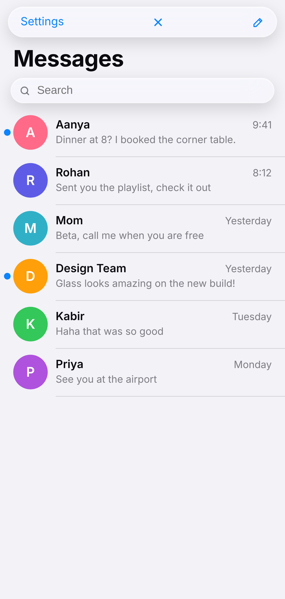
  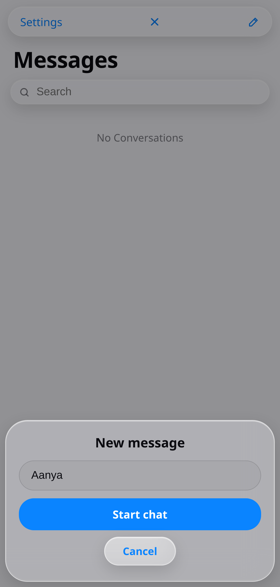
</p>

<p align="center">
  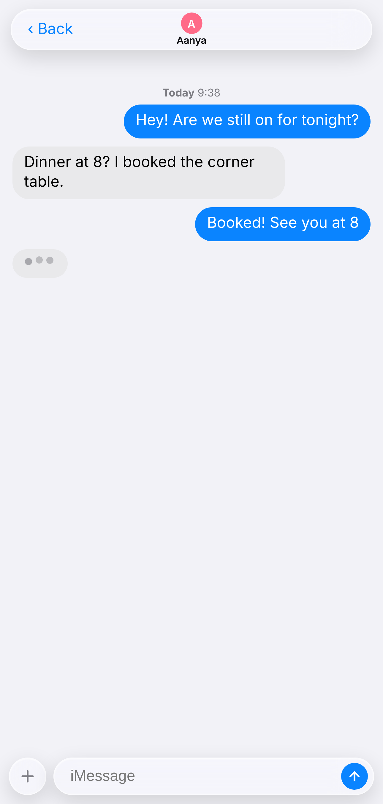
  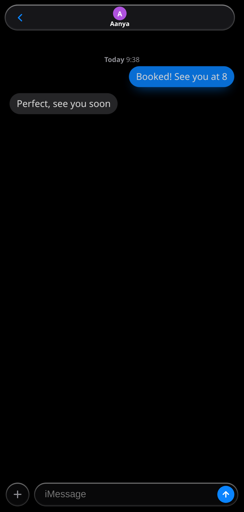
  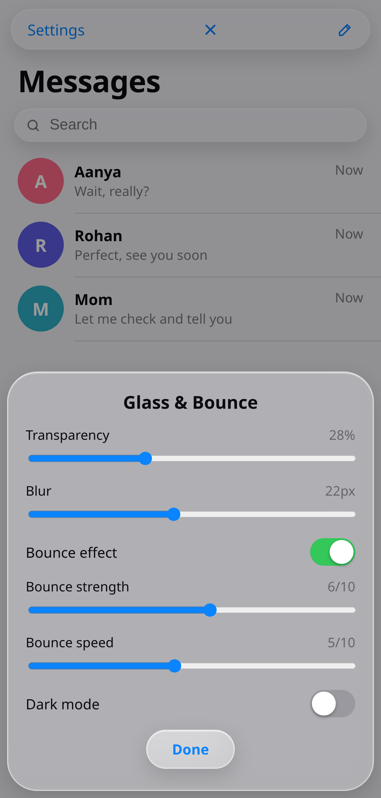
</p>

## Download & install

**[⬇ Download the APK](https://github.com/technicalnihilist-lgtm/ios26-messages-liquid-glass/releases/latest)**

1. Download `Messages-LiquidGlass.apk` to your phone.
2. Tap it and allow *"Install unknown apps"* for your browser or file manager.
3. Open **Messages** from the app drawer.

> **Upgrading from 2.6 or older:** uninstall the old build first. Earlier releases
> were each signed with a key generated during the build, so Android refuses to
> install one over another ("App not installed"). 2.7 is the first build whose key
> is kept for future releases — from here on updates install in place.

| | |
|---|---|
| Package | `com.liquidglass.messages` |
| Version | 2.7 (versionCode 12) |
| Min Android | 7.0 (API 24) |
| Target Android | 14 (API 34) |
| Size | ~70 KB |
| Permissions | `SEND_SMS`, `RECEIVE_SMS`, `READ_SMS`, `RECEIVE_MMS`, `RECEIVE_WAP_PUSH`, `READ_CONTACTS`, notifications |
| Internet | **not requested** — the app cannot reach the network at all |

## What works

- **Liquid glass everywhere** — translucent bars, search field, dock and sheets with
  live `backdrop-filter` blur + saturation over the animated gradient wallpaper.
- **Spring / bounce motion** — a custom multi-keyframe spring curve drives app open,
  close, sheet presentation, message pop-in and press feedback. Strength and speed
  are adjustable at runtime.
- **3D + depth** — the whole UI lives in a real perspective space: bubbles tilt toward
  your finger with a specular highlight, cards and sheets carry layered depth shadows,
  the wallpaper and bars parallax against each other, and messages recede as they
  scroll away (smaller, dimmer, pushed back). Toggle and strength live in Settings.
- **4D motion** — depth is driven by time and movement, not just taps: the wallpaper
  blobs drift on a slow 22–28s cycle, and on a real phone the gyroscope tilts the
  whole scene as you move the handset.
- **Tune it** — Settings has *3D & depth* on/off plus **Depth**, **Parallax** and
  **Tilt** sliders, all saved with your other preferences.
- **Starts empty** — no demo chats, no sample messages. The inbox opens on
  *No Conversations* and fills up with whatever you create.
- **New chat, two ways** — tap the compose button and type a phone number, or tap
  the **+** button beside the message field to pick anyone from your contacts
  (searchable list, straight into a chat).
- **Settings stick** — transparency, blur, bounce strength/speed, the bounce toggle
  and the theme are saved the moment you change them and restored on next launch.
- **Real SMS** — your actual conversations are read from the phone's SMS store,
  messages are sent through `SmsManager`, and incoming texts are written back into
  that store, so nothing is lost.
- **Default messaging app** — a first-run sheet asks to become your default SMS app
  (and Settings has the same switch). Tapping it requests the Android permissions,
  then opens the system role dialog. The app ships every component Android requires
  for that role: `SMS_DELIVER` receiver, `WAP_PUSH_DELIVER` receiver, a
  respond-via-message service and `sms:`/`smsto:`/`mms:`/`mmsto:` intent filters.
- **Messages list** — searchable, relative timestamps, 1:1 and group chats,
  tap-to-open with a parallax push transition.
- **Long-press any bubble** — a glass context menu opens with **Copy** (routed to the
  native Android clipboard) and **Delete** (bubble collapses, water droplets scatter
  and a synthesized water-splash sound plays — no audio files, all Web Audio).
- **Long-press a conversation row** — the row lifts into a floating card with a
  **Delete** action; the chat collapses away with a softer water trickle. Clearing
  the last chat shows the *No Conversations* empty state.
- **Settings sheet** — transparency %, blur radius, bounce strength/speed, bounce
  on/off, and a light/dark theme switch, all applied live.
- **Hardware back button** — unwinds the UI (context menu → sheet → thread → app)
  instead of dumping you out of the app.
- **Dark mode** — follows the in-app switch, and the system theme on first launch.

## Screenshots

| Home | Empty inbox | New chat |
|---|---|---|
|  |  |  |

| Fresh conversation | Inbox after chatting |
|---|---|
| 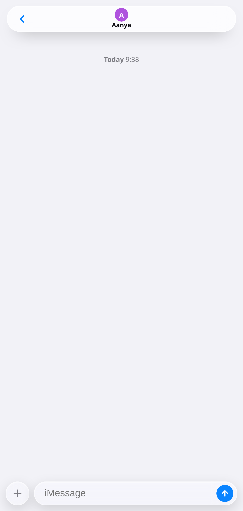 | 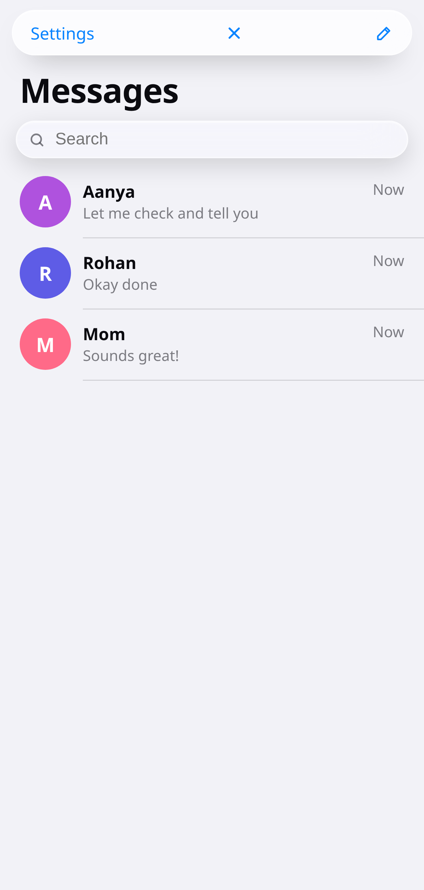 |

| Typing | Reply | Dark |
|---|---|---|
|  | 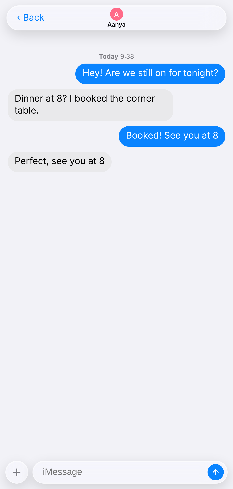 |  |

| Glass & Bounce settings | Long-press bubble |
|---|---|
|  | 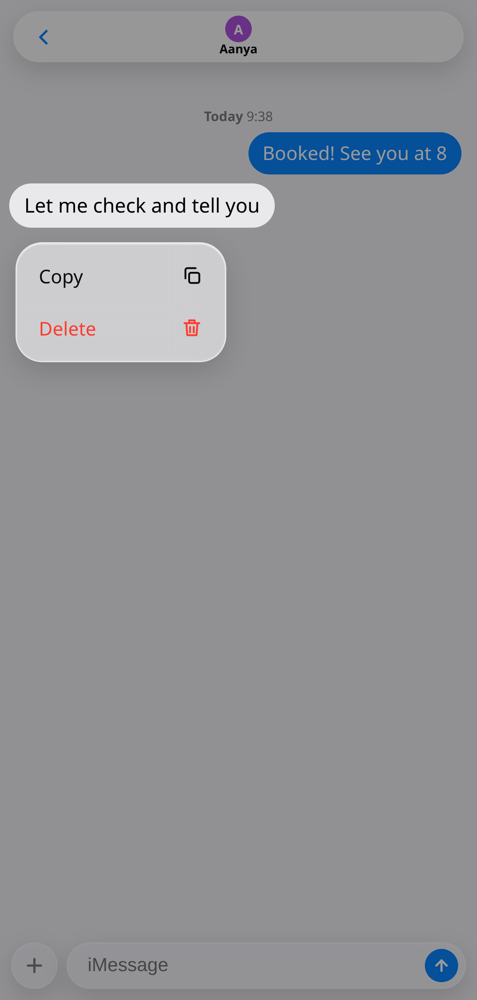 |

| Long-press conversation → delete | Default messaging app prompt | Pick a contact |
|---|---|---|
| 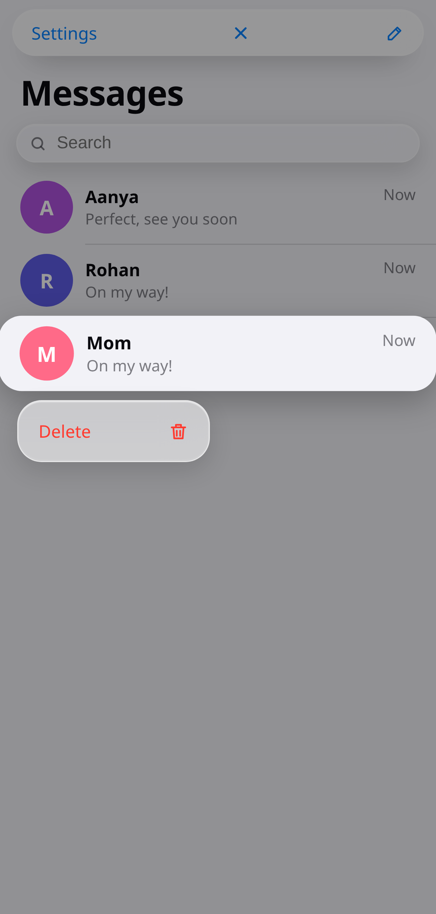 | 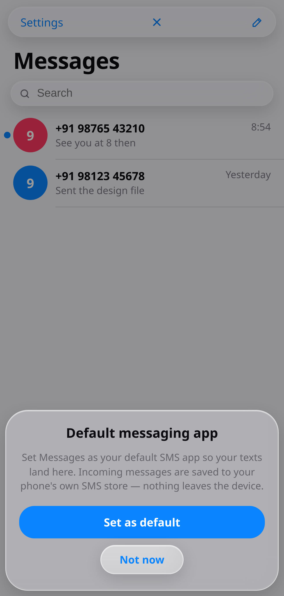 | 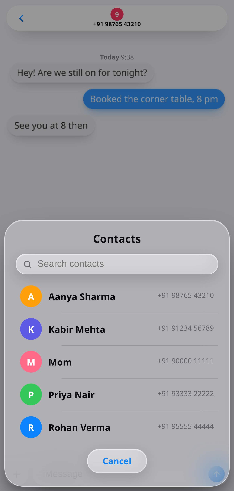 |

| 3D depth in a long thread — near bubbles lift, far ones recede |
|---|
| 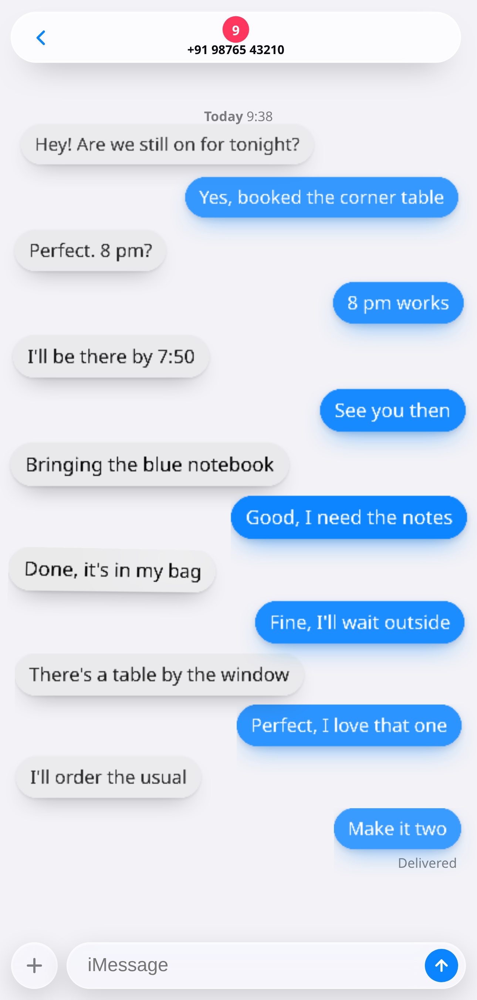 |

## Project layout

```
.
├── app/
│   ├── AndroidManifest.xml
│   ├── assets/index.html          # the entire UI (single file, no dependencies)
│   ├── res/
│   │   ├── values/                # strings, colors, theme
│   │   ├── drawable/              # adaptive icon foreground
│   │   └── mipmap-*/              # launcher icons
│   └── src/com/liquidglass/messages/MainActivity.java
├── build.sh                       # aapt2 → javac → d8 → zipalign → apksigner
├── screenshots/
└── apk/Messages-LiquidGlass.apk
```

## Build it yourself

Requirements: JDK 17, Android build-tools 34, platform `android-34`.

```bash
export JAVA_HOME=/path/to/jdk-17
export ANDROID_SDK=/path/to/android-sdk     # needs build-tools/34.0.0 + platforms/android-34
./build.sh
```

`build.sh` compiles resources with `aapt2`, compiles the single Java class against
`android.jar`, dexes with `d8`, aligns with `zipalign` and signs with `apksigner`.
It generates a local keystore on first run — **replace it with your own key before
publishing to the Play Store**, and **keep that key**: every release must be signed
with the same one, or Android refuses to install it over the previous build.

### Tests

`tests/` runs the bundled HTML in Chromium with a mocked Android bridge — no phone
needed.

```bash
npm install                       # playwright
node tests/ui-tests.js            # 29 behavioural checks
node tests/screenshots.js         # re-renders screenshots/
```

`ui-tests.js` covers boot, opening a thread, sending, delete + tombstones, the
poll/receive path, HTML escaping, settings persistence, the default-SMS flow, the
hardware-back chain and the 3D depth engine, and times a 300-message thread. Three
of the checks are regressions from 2.7: a poll must not drop a conversation you just
composed, composing an existing number must not clone it, and an incoming message
must not rebuild the thread under an open long-press menu.

## What's new in 2.7 — sends that land, conversations that stay

**Fixed**

- **A text was silently not sent in a brand-new conversation.** Compose a number,
  wait a few seconds, type and tap Send — and nothing happened at all: no bubble, no
  `sendSms`, nothing. The 6-second poll rebuilt the conversation list from the SMS
  store, and a conversation you had just composed has no provider id yet, so it was
  dropped from the list, the open-thread pointer went to `null` and `sendMsg()` returned
  on its first line. Conversations that exist only on this side now survive the rebuild,
  and the open thread is still resolved by address.
- **Composing a number that already had a conversation made a second one.** Two rows for
  the same person — one real, one empty — until the next poll cleaned it up. A composed
  address is now matched against the list first (ignoring formatting, so
  `+91 98765 43210` and `+919876543210` are the same person) and the existing thread
  opens instead of a copy.
- **A tap on a conversation could open a different one.** The row handler waited 120 ms
  before opening `T[index]`, and a poll landing in that window renumbered the list. The
  tap now carries the conversation's id and address and is resolved when it opens.
- **An incoming message rebuilt the thread underneath an open long-press menu.** The
  bubble the menu was anchored to was replaced by a fresh copy of itself, so the floating
  ghost ended up sitting on top of a duplicate, and Delete pointed at an element that no
  longer existed. Re-renders are deferred while the menu is open and flushed when it
  closes.
- **An empty conversation showed the current clock as its date stamp.** `stampFor()` read
  a `date` field the thread list never stored and fell back to `Date.now()`, so the stamp
  changed on every launch (and made the screenshot non-reproducible). The list keeps the
  raw date and the stamp uses it.
- **Two sheets could be open at once** — Settings while the default-SMS prompt appeared
  over it, or any sheet over another. Only one sheet is shown at a time, and the prompt
  no longer interrupts a conversation.
- **`markRead` was declared twice in the JS bridge.** The WebView registers bridge
  methods by name, so one overload silently replaced the other and a call carrying the
  address could throw. There is a single method now, and it always takes the address.
- **A deleted conversation could come back as a separate row.** Local backup copies were
  matched to provider rows by exact string, so the same number written two ways produced
  two conversations. Matching now normalises the number; the address shown is unchanged.
- **Synthetic thread ids could collide with real ones.** `Math.abs(Integer.MIN_VALUE)` is
  still negative, so the "negative" id for a local-only conversation came out positive
  and could shadow a provider thread.
- **A zero-size bubble divided by zero** in the tilt handler, writing `NaNdeg` into the
  CSS variables.

**Optimised** (measured in the harness on a 300-message thread, median of 7)

- **Scroll depth stopped formatting strings.** The change signature was
  `k.toFixed(3)+'|'+s.toFixed(3)` — two `toFixed()` calls per bubble per frame, 600 of
  them on a 300-message thread. It is one integer compare now: 0.33 ms → 0.28 ms per
  frame when nothing has moved, and ~15.0 ms → ~14.1 ms when the harness forces a
  layout on every frame (most of that is the scroll's own layout and paint, not the
  depth pass).
- **The 6-second poll no longer goes quadratic in Java.** `threadsJson()` compared every
  stored message against every conversation (up to 300 × 800 string comparisons per
  poll), and `messagesJson()` de-duplicated stored copies against every row of the
  thread (300 × 300 per poll). Both use an index now. This is the work that runs every
  6 seconds while a conversation is open, on the JavaBridge thread.
- **Notification channels are created once per process**, not on every message.
- The thread is now built as one array and joined once instead of 300 string
  concatenations. Neutral in the benchmark (V8 handles both), kept because it reads
  better and cannot regress.

**Reported, not patched** (each would change the approved design)

- The bar/blob parallax transform string is missing its closing parenthesis and the blob
  transform is overridden by the infinite drift animation, so neither the bars nor the
  wallpaper actually move on tilt. Repairing either one is a motion change, so it stays
  as approved.
- `applyParallax()` also writes `transform` on `.blob` elements whose `drift` animation
  owns that property — same story.

## What's new in 2.6 — nothing gets stuck, nothing disappears

**Fixed**

- **The sheet, the menu and the app-close could stay stuck open forever.** All three
  removed their `on` class only from the Web Animation's `onfinish`. If that animation
  was cancelled — replaced by another animation on the same property, or a tab that was
  never given a frame — the sheet stayed up over a dimmed screen and nothing could be
  touched again. Every one of those animations now settles on finish, on cancel, or on
  a timeout, and so does the delete chain.
- **A delete could hit the wrong message.** The bubble menu remembered the message by
  its *index* and read `T[cur].m[i]` when the animation ended — half a second later.
  A 6-second poll that reordered the conversation in that window deleted a different
  text, or the wrong conversation. The thread and message are snapshotted when the menu
  opens and matched again when the delete lands.
- **A sent text vanished from the thread when the app was not the default SMS app.**
  The system provider refuses that write unless you hold the role, and the app kept no
  copy of its own — so 900 ms later the bubble was gone. Outgoing texts now fall back
  to the app's own store with their direction, so they still render as blue bubbles.
  Quick replies through `HeadlessSmsSendService` get the same treatment.
- **Queued, outbox and failed messages rendered as incoming.** They are outgoing.
- **A multi-line SMS collapsed into one line.** Bubbles keep their line breaks now.
- **One notification per message, forever.** Every text got a random notification id,
  so the shade filled up with them. It is one notification per conversation now, and
  opening that conversation clears it.
- **"Set as default" raced the permission dialog.** The role request fired on a 700 ms
  timer, so it could land while the permission dialog was still up and be dropped. The
  role request now waits for the permission result before it opens.
- **The 6-second refresh scanned the whole SMS table** even when you had four threads;
  it now stops after 300 conversations / 5,000 rows.
- **A flash of the app at full size on launch.** The shell added `on` immediately and
  then sprang the app up from 25 % a quarter second later, so it painted full size,
  jumped small, and grew. The spring now owns the first paint.
- **A bubble went flat while your finger was on it**, and again while a just-sent bubble
  popped in: both animations replaced the 3D transform instead of composing with it.
- **Releasing a touch flattened every bubble in the thread**, dropping the scroll depth
  until the next scroll. Only the bubble you touched is released now.
- **Copy** no longer leaves an unhandled promise rejection when the clipboard refuses.
- `android:allowBackup` is off: the local SMS copies and settings should never be
  uploaded to a cloud backup, and the README promises nothing leaves the device.

**Faster**

- Scroll depth measures the thread **once per render** instead of one client rect per
  bubble per frame, and reuses the layout instead of forcing a relayout after every
  write: **9.5 ms → 3.7 ms per frame** on a 300-message thread in the harness.
- The conversation list and the thread it opens now move on the same curve for the same
  duration — the list used to finish its push 250 ms before the thread arrived.
- Pointer parallax and bubble tilt are throttled to one update per frame instead of one
  per pointer event.
- The splash sound reuses a single noise buffer instead of filling 1–2 s of random
  samples on every delete.

**Left alone on purpose** (fixing them would visibly change approved motion, so they
are reported rather than patched):

- The nav-bar parallax string is still missing its closing paren. The CSS parser
  tolerates it and the bars do shift, so this is cosmetic only — left as approved.
- The wallpaper blobs' parallax transform is still overridden by the infinite `drift`
  animation, so they drift but do not follow the pointer. Making them follow would
  change how the wallpaper moves.
- The safe-area inset is applied twice (`:root` padding and `.scroll` padding). It is
  0 inside the WebView shell, so nothing moves today; changing it would shift every
  screen on a notched phone.

**Note:** this APK is signed with the build machine's local dev key, which differs from
the one used for 2.5 — uninstall the old build before installing this one.


## What's new in 2.5 — safety, correctness and speed

**Fixed**

- **Text from a real SMS could run code in the app.** Message bodies, conversation
  names and contact names were written into the page as raw HTML, so a text
  containing markup was parsed by the WebView — which has the SMS bridge attached.
  Everything that comes out of the SMS store or the contact list is now escaped.
- **The date above a conversation was hardcoded** to *"Today 9:38"* in every thread,
  forever. It now shows the real date of the oldest message: *Today 9:38*,
  *Yesterday 14:05* or *Tue 14:05*.
- **Reading history got yanked away.** Every 6-second refresh (and every incoming
  text) re-rendered the thread and jumped to the bottom, even if you had scrolled up.
  The scroll position is now kept unless you were already at the bottom.
- **Transparency, Blur, Bounce strength and Bounce speed were never saved** when you
  moved them — they only got written when some *other* control was touched, so they
  reverted on the next launch. They persist now.
- **No notification for incoming texts while the app held the default-SMS role** —
  only the fallback receiver notified. Both paths notify now, exactly once.
- **A text could be lost if the system provider refused the insert** while the app was
  the default app. It now falls back to the app's own store, like the other path.
- **The unread dot never cleared** for messages kept in the app's backup store: the
  merge step marked them unread again on every refresh. Read time is now recorded per
  conversation.
- **Deleting a conversation with no system thread id did nothing.** It now tombstones
  and removes the local copies.
- **`smsto:` intents that arrived while the page was still loading were dropped.**
  The address is queued until the page is up.
- **The long-press menu could be dismissed by the click that ends the press** on some
  devices. The dimmed backdrop now ignores a click within 400 ms of opening the menu.
- **Copy on a message that had just been deleted** threw an uncaught `TypeError`.
- `HeadlessSmsSendService` used the deprecated `SmsManager.getDefault()` and could
  crash on a null manager; it uses the system service on Android 12+.

**Faster**

- Scroll depth is computed with one read pass and one write pass (no forced layout per
  bubble) and skips bubbles whose depth has not changed: **21 ms → 7 ms per frame**
  on a 300-message thread in the test harness.
- Parallax no longer queries the DOM and re-measures the phone on every pointer move.
- The 6-second poll only reloads the open conversation when the conversation list
  actually changed — one database query per poll instead of two.
- Launching no longer writes all ten preferences to `SharedPreferences` four times
  over; nothing is written until you touch a setting.
- Tombstones are indexed once instead of re-parsing the stored JSON for every message
  while a thread loads.

**Left alone on purpose** (fixing them would visibly change the approved motion, so
they are reported rather than patched):

- The nav-bar parallax writes an invalid transform (`translate3d(x,y,0` with no closing
  paren), so the bars never actually shift. Repairing it would slide both bars by up to
  ~18 px as you tilt the phone.
- The wallpaper blobs' parallax transform is overridden by the infinite `drift`
  animation, so they drift but do not follow the pointer.

**Note:** this APK is signed with the build machine's local dev key, which differs from
the one used for 2.4 — uninstall the old build before installing this one.


## What's new in 2.4 — deletes stay deleted

- **Deleting a message now sticks.** Previously a deleted text came straight back:
  the app keeps its own backup copy of every received SMS, so after the system row was
  removed the backup copy was merged back in on the next refresh.
- Every delete now writes a **tombstone** (address + body + timestamp) before anything
  else happens. The merge step skips anything tombstoned, and the receiver refuses to
  re-store a tombstoned message — so a deleted text can never reappear, while new
  messages from the same person still arrive normally.
- Covers all three paths: deleting a single provider message, deleting a
  backup-only message (no provider id), and deleting a whole conversation.
- Deleting a conversation now also tombstones every message inside it, so the thread
  does not come back after a refresh.

## What's new in 2.3 — incoming messages fixed

- **New texts now actually arrive.** Four things were missing or fragile, all fixed:
  - every received SMS is stored in the app's own backup store *before* anything else,
    so a failed provider insert can no longer swallow it;
  - a `SMS_RECEIVED` receiver was added for the case where the app is not the default
    SMS app yet (Android only sends `SMS_DELIVER` to the default app);
  - a notification is posted for every incoming text, so it is visible even when the
    app is closed;
  - the open app now polls the store every 6 seconds (and on resume), so a thread
    updates on its own instead of waiting for a restart.
- Also fixed: the `SEEN` column was written on Android 7/8 where it does not exist,
  which could make the whole insert throw — the message is now saved either way.
- **More depth, and control over it**: new **Parallax** and **Tilt** sliders next to
  **Depth**; scroll depth is stronger (recession, tilt and dimming), tilt rotates
  further toward your finger, and all three values persist.
- Settings sheet compacted so the *Done* button no longer falls off the screen.

## What's new in 2.2 — 3D, depth and motion

- **3D tilt**: press or drag across a bubble and it rotates toward the pointer
  (`rotateX`/`rotateY` in a 1100px perspective) with a soft specular highlight that
  follows the touch point.
- **Depth effect**: every layer now has its own elevation — bubbles, bars, sheets and
  the dock carry multi-layer shadows, and scrolling a conversation pushes distant
  bubbles back in Z, shrinks them slightly and dims them, so the thread reads as a
  corridor instead of a flat list.
- **Parallax**: the wallpaper blobs, the navigation bar and the content move at
  different rates as you move your finger — and via `deviceorientation`, as you tilt
  the phone.
- **4D (time)**: the background drifts on a slow ambient cycle, so the scene breathes
  even when you are not touching it.
- **Controls**: new *3D & depth* switch and *Depth* strength slider in Settings, both
  saved with the rest of your preferences.
- Tap targets stay intact — the depth engine only uses non-negative Z, so bubbles
  never slip behind their parent plane (that used to break long-press).

## What's new in 2.1

- **The `+` button works**: it opens a searchable contact picker (real contacts, via
  `READ_CONTACTS`) and jumps straight into a chat with whoever you tap.
- **Settings and theme persist**: transparency, blur, bounce strength/speed, the
  bounce switch and light/dark are stored in native `SharedPreferences` and restored
  on launch. Picking light keeps light, picking dark keeps dark — the system theme no
  longer overrides your choice after a restart.
- **Thread header fixed**: the back chevron and the contact title were overlapping;
  the bar is now a proper three-column layout with an ellipsised title, and it stays
  readable on devices where the blur is weak.
- Fixed contact avatars sometimes rendering with no colour.

## What's new in 2.0 — real messaging

- **Real SMS**: threads and messages come from the Android SMS provider; sending uses
  `SmsManager` and also records the outgoing text.
- **Default SMS app**: first-run prompt + a Settings switch. Requests permissions,
  then the system role dialog. Includes every component the role requires.
- **Incoming texts are safe**: the `SMS_DELIVER` receiver writes each message into the
  system SMS store itself, so it survives even if the UI is closed.
- **`sms:`/`smsto:` links** from contacts or the dialer open straight into a chat.
- The old fake auto-reply is gone — the other side is a real person now.
- Fixed a container-scroll bug that could shift the whole UI sideways after using
  the keyboard.

### Known limitation
**MMS is not downloaded.** The app declares the required MMS receiver to qualify for
the role, but full MMS (WAP push download) is out of scope here — when an MMS arrives
you get a notification saying so, instead of the message vanishing silently.

## What's new in 1.3

- **Demo content removed** — the six seeded chats and their messages are gone.
  The app starts on an empty *No Conversations* inbox.
- **New-chat flow** — the compose sheet now has a *To: name* field and a
  **Start chat** button; no more picking from a hard-coded contact list.
- **Default auto-reply** — every message you send gets an answer, so a brand-new
  conversation behaves like a real one.
- Screenshots re-rendered for the empty inbox, the new-chat sheet and a real inbox.

## What's new in 1.2

- Long-press a conversation row to delete the whole chat, with a softer water
  trickle, droplet particles and a lift-and-collapse animation.
- *No Conversations* empty state once the list is cleared.
- Guard so a long-press never opens the chat by accident when you release.
- Haptic nudge on the row menu (browser/PWA; the APK runs without the VIBRATE
  permission by design, so there it is a silent no-op).

## What's new in 1.1

- Long-press context menu on every bubble: **Copy** and **Delete**.
- Delete animation with droplet particles and a procedural water-splash sound
  (Web Audio synthesis — the APK ships no audio files).
- Copy goes through a native `ClipboardManager` bridge, because
  `navigator.clipboard` is unreliable on `file://` inside a WebView.
- Thread header avatar no longer overflows the navigation bar.
- Full-bleed layout — the old 900 px preview cap that left a black strip is gone.

## Technical notes

- The WebView is locked down: JavaScript and DOM storage are enabled (the UI needs
  them), while zoom, overscroll, scrollbars, safe browsing and all URL navigation
  away from `file:///android_asset/` are disabled.
- `backdrop-filter` requires Chrome WebView 76+ — present on any device on Android 7
  that has received Play Store updates (effectively all of them). On the rare device
  without it, the glass falls back to a solid tint; the app stays fully usable.
- `window.__androidBack()` is the bridge the Java layer calls from `onBackPressed()`.
- The JS bridge (`Android.*`) is deliberately narrow: clipboard copy, SMS read/send/
  delete, contact lookup, preference get/set, permission and role requests. There is no network access and no file access
  beyond the bundled assets.
- Everything SMS-related goes through the standard provider (`content://sms`), so
  other SMS apps can still read the same store if you switch back.
- Received messages are additionally mirrored into a small local backup store
  (`SharedPreferences`) and merged, de-duplicated, back into the list — that is the
  safety net that makes "a message arrived but never showed up" impossible.
- Deletions are recorded as tombstones in the same store and filtered out of every
  merge, which is what keeps a deleted message deleted.
- The depth engine is transform-only and rAF-throttled: scroll depth recomputes once
  per frame, parallax writes CSS custom properties, and nothing touches layout. Bubble
  geometry is measured once per render (not per frame), and the per-bubble change check
  is an integer compare.
- Bubbles, avatars and all colour are original CSS — no Apple assets are bundled.
  This is a design study, not an Apple product, and is not affiliated with Apple Inc.

## License

MIT — see [LICENSE](LICENSE).

---

## ⭐ Like this work? Give it a star

If you like this app and our work, please **star this repository** ⭐ and **[follow technicalnihilist-lgtm on GitHub](https://github.com/technicalnihilist-lgtm)**. If our work isn't for you, that's completely fine — the choice is yours. Thank you for stopping by!

<details>
<summary><b>🌍 Same message in 32 languages (A–Z + Indian languages)</b></summary>

- **A — Arabic** (العربية): ⭐ إذا أعجبك هذا التطبيق وعملنا، فيرجى منح المستودع نجمة ومتابعتنا. وإذا لم يعجبك عملنا، فلا مشكلة على الإطلاق — القرار قرارك. شكرًا لزيارتك!
- **B — Bengali** (বাংলা): ⭐ যদি আপনার এই অ্যাপ এবং আমাদের কাজ ভালো লাগে, তবে অনুগ্রহ করে রিপোজিটরিটিকে একটি স্টার দিন এবং আমাদের ফলো করুন। আমাদের কাজ যদি আপনার পছন্দ না হয়, তাতেও কোনো সমস্যা নেই — সিদ্ধান্ত আপনার। আমাদের পেজে আসার জন্য ধন্যবাদ!
- **C — Chinese** (中文): ⭐ 如果你喜欢这个应用和我们的作品，请给仓库点个星标并关注我们。如果我们的作品不适合你，也完全没关系——选择权在你。感谢你的到访！
- **D — Dutch** (Nederlands): ⭐ Vind je deze app en ons werk leuk? Geef de repository dan een ster en volg ons. Vind je ons werk niets, dan is dat helemaal prima — de keuze is aan jou. Bedankt voor je bezoek!
- **E — English** (English): ⭐ If you like this app and our work, please give the repository a star and follow us. If our work isn't for you, that's completely fine — the choice is yours. Thank you for stopping by!
- **F — French** (Français): ⭐ Si cette application et notre travail vous plaisent, mettez une étoile au dépôt et suivez-nous. Si notre travail n'est pas pour vous, aucun souci — c'est votre choix. Merci de votre visite !
- **G — German** (Deutsch): ⭐ Wenn dir diese App und unsere Arbeit gefallen, gib dem Repository einen Stern und folge uns. Wenn unsere Arbeit nichts für dich ist, ist das völlig in Ordnung — die Wahl liegt bei dir. Danke fürs Vorbeischauen!
- **H — Hindi** (हिन्दी): ⭐ अगर आपको यह ऐप और हमारा काम पसंद है, तो कृपया रिपॉजिटरी को स्टार दें और हमें फॉलो करें। अगर हमारा काम आपके लिए नहीं है, तो भी कोई बात नहीं — यह पूरी तरह आपकी मर्ज़ी है। यहाँ आने के लिए आपका धन्यवाद!
- **I — Indonesian** (Bahasa Indonesia): ⭐ Jika kamu suka aplikasi ini dan karya kami, beri bintang pada repositori ini dan ikuti kami. Kalau karya kami bukan untukmu, tidak masalah sama sekali — itu pilihanmu. Terima kasih sudah mampir!
- **J — Japanese** (日本語): ⭐ このアプリと私たちの仕事が気に入ったら、リポジトリにスターを付けてフォローしてください。合わない場合はまったく問題ありません — 選ぶのはあなたです。お越しいただきありがとうございます！
- **K — Korean** (한국어): ⭐ 이 앱과 저희 작업이 마음에 드신다면 저장소에 스타를 눌러 주시고 팔로우해 주세요. 저희 작업이 맞지 않으셔도 전혀 괜찮습니다 — 선택은 여러분의 몫입니다. 방문해 주셔서 감사합니다!
- **L — Lithuanian** (Lietuvių): ⭐ Jei tau patinka ši programa ir mūsų darbas, duok saugyklai žvaigždutę ir sek mus. Jei mūsų darbas ne tau, viskas gerai — pasirinkimas tavo. Ačiū, kad užsukai!
- **M — Malayalam** (മലയാളം): ⭐ നിങ്ങൾക്ക് ഈ ആപ്പും ഞങ്ങളുടെ പ്രവർത്തനവും ഇഷ്ടപ്പെട്ടെങ്കിൽ, ദയവായി റെപ്പോസിറ്ററിക്ക് ഒരു സ്റ്റാർ നൽകുകയും ഞങ്ങളെ ഫോളോ ചെയ്യുകയും ചെയ്യുക. ഞങ്ങളുടെ പ്രവർത്തനം നിങ്ങൾക്ക് അനുയോജ്യമല്ലെങ്കിൽ, അതും തികച്ചും കുഴപ്പമില്ല — തീരുമാനം നിങ്ങളുടേതാണ്. ഇവിടെ വന്നതിന് നന്ദി!
- **N — Nepali** (नेपाली): ⭐ यदि तपाईंलाई यो एप र हाम्रो काम मन पर्‍यो भने, कृपया रिपोजिटरीलाई स्टार दिनुहोस् र हामीलाई फलो गर्नुहोस्। यदि हाम्रो काम तपाईंलाई मन पर्दैन भने, पनि ठीकै छ — यो तपाईंको इच्छा हो। यहाँ आउनुभएकोमा धन्यवाद!
- **O — Odia** (ଓଡ଼ିଆ): ⭐ ଯଦି ଆପଣଙ୍କୁ ଏହି ଆପ୍ ଏବଂ ଆମର କାମ ଭଲ ଲାଗୁଛି, ତେବେ ଦୟାକରି ରିପୋଜିଟୋରୀକୁ ଗୋଟିଏ ଷ୍ଟାର୍ ଦିଅନ୍ତୁ ଏବଂ ଆମକୁ ଫଲୋ କରନ୍ତୁ। ଯଦି ଆମର କାମ ଆପଣଙ୍କ ପାଇଁ ନୁହେଁ, ତେବେ କିଛି ଅସୁବିଧା ନାହିଁ — ପସନ୍ଦ ଆପଣଙ୍କର। ଆମ ପାଖକୁ ଆସିଥିବାରୁ ଧନ୍ୟବାଦ!
- **P — Polish** (Polski): ⭐ Jeśli podoba Ci się ta aplikacja i nasza praca, daj repozytorium gwiazdkę i obserwuj nas. Jeśli nasza praca nie jest dla Ciebie, to zupełnie w porządku — wybór należy do Ciebie. Dziękujemy za odwiedziny!
- **Q — Quechua** (Runa Simi): ⭐ Kay app, ñuqaykup ruwasqanchikpas gustasunki chayqa, repositorioman huk estrella churay, ñuqaykutapas qatipayku. Mana gustasunki chayqa, allinmi — qampa akllayki. Hamusqaykimanta sulpayki!
- **R — Russian** (Русский): ⭐ Если вам нравится это приложение и наша работа, поставьте звёздочку репозиторию и подпишитесь на нас. Если наша работа не для вас — это совершенно нормально, выбор за вами. Спасибо, что заглянули!
- **S — Spanish** (Español): ⭐ Si te gusta esta app y nuestro trabajo, dale una estrella al repositorio y síguenos. Si nuestro trabajo no es para ti, no pasa nada — la decisión es tuya. ¡Gracias por pasarte!
- **T — Tamil** (தமிழ்): ⭐ உங்களுக்கு இந்த ஆப்பும் எங்க வேலையும் பிடிச்சிருந்தா, தயவுசெஞ்சு இந்த ரெபாசிட்டரிக்கு ஒரு ஸ்டார் குடுத்து, எங்களை ஃபாலோ பண்ணுங்க. எங்க வேலை உங்களுக்கு செட் ஆகலைன்னாலும் பரவாயில்லை — அது உங்க விருப்பம். இங்கே வந்ததுக்கு நன்றி!
- **U — Urdu** (اردو): ⭐ اگر آپ کو یہ ایپ اور ہمارا کام پسند آئے تو براہ کرم ریپازٹری کو سٹار دیں اور ہمیں فالو کریں۔ اگر ہمارا کام آپ کے لیے نہیں ہے، تو یہ بالکل ٹھیک ہے — انتخاب آپ کا ہے۔ یہاں تشریف لانے کا شکریہ!
- **V — Vietnamese** (Tiếng Việt): ⭐ Nếu bạn thích ứng dụng này và công việc của chúng tôi, hãy tặng kho lưu trữ một ngôi sao và theo dõi chúng tôi. Nếu công việc của chúng tôi không phù hợp với bạn, điều đó hoàn toàn ổn — lựa chọn là của bạn. Cảm ơn bạn đã ghé qua!
- **W — Welsh** (Cymraeg): ⭐ Os ydych chi'n hoffi'r ap hwn a'n gwaith, rhowch seren i'r storfa a dilynwch ni. Os nad yw ein gwaith ar eich cyfer, mae hynny'n hollol iawn — chi sydd i benderfynu. Diolch am alw heibio!
- **X — Xhosa** (isiXhosa): ⭐ Ukuba uyayithanda le app nomsebenzi wethu, nika irepo inkwenkwezi kwaye usilandele. Ukuba umsebenzi wethu awukufanelanga, akukho ngxaki — lukhetho lwakho. Enkosi ngokutyelela!
- **Y — Yoruba** (Yorùbá): ⭐ Bí app yìí àti iṣẹ́ wa bá wù ọ́, jọ̀wọ́ fún àkójọpọ̀ náà ní ìràwọ̀ kí o sì tẹ̀lé wa. Bí iṣẹ́ wa kò bá yẹ ọ́, kò séwu — ìwọ ni ó yàn. Ẹ ṣé fún wíwá!
- **Z — Zulu** (isiZulu): ⭐ Uma uthanda le app nomsebenzi wethu, nikeza isitoreji inkanyezi bese usilandela. Uma umsebenzi wethu ungakufanele, akunankinga — wukukhetha kwakho. Siyabonga ngokuvakasha!

**More Indian languages**

- **Assamese** (অসমীয়া): ⭐ যদি আপুনি এই এপটো আৰু আমাৰ কাম ভাল পায়, তেন্তে অনুগ্ৰহ কৰি ৰিপজিটৰীটোক এটা ষ্টাৰ দিয়ক আৰু আমাক ফ'ল' কৰক। যদি আমাৰ কাম আপোনাৰ বাবে নহয়, তেন্তে সেয়া একেবাৰে ঠিক আছে — সিদ্ধান্তটো আপোনাৰ। আমাৰ ইয়ালৈ অহাৰ বাবে ধন্যবাদ!
- **Gujarati** (ગુજરાતી): ⭐ જો તમને આ એપ અને અમારું કામ ગમતું હોય, તો પ્લીઝ રિપોઝિટરીને સ્ટાર આપો અને અમને ફોલો કરો. જો અમારું કામ તમને ન ગમતું હોય, તો તે પણ બરાબર છે — પસંદગી તમારી છે. અહીં આવવા બદલ આભાર!
- **Kannada** (ಕನ್ನಡ): ⭐ ನಿಮಗೆ ಈ ಆ್ಯಪ್ ಮತ್ತು ನಮ್ಮ ಕೆಲಸ ಇಷ್ಟವಾದರೆ, ದಯವಿಟ್ಟು ರೆಪೊಸಿಟರಿಗೆ ಸ್ಟಾರ್ ಕೊಡಿ ಮತ್ತು ನಮ್ಮನ್ನು ಫಾಲೋ ಮಾಡಿ. ನಮ್ಮ ಕೆಲಸ ನಿಮಗೆ ಸರಿಹೊಂದದಿದ್ದರೆ, ಅದೂ ಪರವಾಗಿಲ್ಲ — ಆಯ್ಕೆ ನಿಮ್ಮದು. ಭೇಟಿ ನೀಡಿದ್ದಕ್ಕೆ ಧನ್ಯವಾದಗಳು!
- **Marathi** (मराठी): ⭐ जर तुम्हाला हे ॲप आणि आमचं काम आवडलं असेल, तर कृपया रिपॉझिटरीला स्टार द्या आणि आम्हाला फॉलो करा. जर आमचं काम तुम्हाला आवडत नसेल, तर काही हरकत नाही — ती तुमची निवड आहे. इथे आल्याबद्दल धन्यवाद!
- **Punjabi** (ਪੰਜਾਬੀ): ⭐ ਜੇ ਤੁਹਾਨੂੰ ਇਹ ਐਪ ਅਤੇ ਸਾਡਾ ਕੰਮ ਪਸੰਦ ਹੈ, ਤਾਂ ਕਿਰਪਾ ਕਰਕੇ ਰਿਪੋਜ਼ਟਰੀ ਨੂੰ ਸਟਾਰ ਦਿਓ ਅਤੇ ਸਾਨੂੰ ਫਾਲੋ ਕਰੋ। ਜੇ ਸਾਡਾ ਕੰਮ ਤੁਹਾਡੇ ਲਈ ਨਹੀਂ ਹੈ, ਤਾਂ ਕੋਈ ਗੱਲ ਨਹੀਂ — ਚੋਣ ਤੁਹਾਡੀ ਹੈ। ਸਾਡੇ ਪੇਜ 'ਤੇ ਆਉਣ ਲਈ ਧੰਨਵਾਦ!
- **Telugu** (తెలుగు): ⭐ మీకు ఈ యాప్, మా పని నచ్చితే, దయచేసి రిపోజిటరీకి ఒక స్టార్ ఇచ్చి మమ్మల్ని ఫాలో అవ్వండి. ఒకవేళ మా పని మీకు నచ్చకపోతే, పర్వాలేదు — అది మీ ఇష్టం. మమ్మల్ని సందర్శించినందుకు ధన్యవాదాలు!

</details>
