<div align="center">


<a href="https://github.com/technicalnihilist-lgtm/ios26-messages-liquid-glass/stargazers"></a>&nbsp;<a href="https://github.com/technicalnihilist-lgtm/ios26-messages-liquid-glass/network/members"></a>

<a href="https://github.com/technicalnihilist-lgtm/ios26-messages-liquid-glass/releases/latest/download/Messages-LiquidGlass.apk"></a> <a href="https://technicalnihilist-lgtm.github.io/apps-site/apps/ios26-messages-liquid-glass.html"></a>

<b>Support the work</b>

  

<sub>Donations aren't live yet — Paytm, UPI, PayPal and Buy&nbsp;Me&nbsp;a&nbsp;Coffee all show <b>coming soon</b>. Until then, a ⭐ star is the best support.</sub>

<a href="https://github.com/technicalnihilist-lgtm/ios26-messages-liquid-glass/releases/latest"></a>  <a href="https://github.com/technicalnihilist-lgtm/ios26-messages-liquid-glass/releases"></a>

</div>

---

## Download & install

**[⬇ Download the APK](https://github.com/technicalnihilist-lgtm/ios26-messages-liquid-glass/releases/latest)**

1. Download `Messages-LiquidGlass.apk` to your phone.
2. Tap it and allow *"Install unknown apps"* for your browser or file manager.
3. Open **Messages** from the app drawer.

> **Upgrading:** if Android says *"App not installed"*, uninstall the old build and
> install the new one. Every build is signed with the key generated by `build.sh` on
> the machine that produced it, and that keystore is not kept in this repository, so
> two builds from different machines carry different signatures. Commit your own
> `release.keystore` (or store it as a CI secret) and every later release will then
> install in place over this one.

| | |
|---|---|
| Package | `com.liquidglass.messages` |
| Version | 2.19 (versionCode 24) |
| Min Android | 7.0 (API 24) |
| Target Android | 14 (API 34) |
| Size | ~81 KB |
| Permissions | `SEND_SMS`, `RECEIVE_SMS`, `READ_SMS`, `RECEIVE_MMS`, `RECEIVE_WAP_PUSH`, `READ_CONTACTS`, notifications |
| Internet | **not requested** — the app cannot reach the network at all |

## What works

- **Liquid glass everywhere** — translucent bars, search field, dock and sheets with
  live `backdrop-filter` blur + saturation over the animated gradient wallpaper.
- **Spring / bounce motion** — a custom multi-keyframe spring curve drives app open,
  close, sheet presentation, message pop-in and press feedback. Strength and speed
  are adjustable at runtime.
- **3D + depth** — the whole UI lives in a real perspective space: bubbles tilt toward
  your finger with a specular highlight, cards and sheets carry layered depth shadows,
  the wallpaper and bars parallax against each other, and messages recede as they
  scroll away (smaller, dimmer, pushed back). Toggle and strength live in Settings.
- **4D motion** — depth is driven by time and movement, not just taps: the wallpaper
  blobs drift on a slow 22–28s cycle, and on a real phone the gyroscope tilts the
  whole scene as you move the handset.
- **Tune it** — Settings has *3D & depth* on/off plus **Depth**, **Parallax** and
  **Tilt** sliders, all saved with your other preferences.
- **Starts empty** — no demo chats, no sample messages. The inbox opens on
  *No Conversations* and fills up with whatever you create.
- **New chat, two ways** — tap the compose button and type a phone number, or tap
  the **+** button beside the message field to pick anyone from your contacts
  (searchable list, straight into a chat).
- **Settings stick** — transparency, blur, bounce strength/speed, the bounce toggle
  and the theme are saved the moment you change them and restored on next launch.
- **Real SMS** — your actual conversations are read from the phone's SMS store,
  messages are sent through `SmsManager`, and incoming texts are written back into
  that store, so nothing is lost.
- **Default messaging app** — a first-run sheet asks to become your default SMS app
  (and Settings has the same switch). Tapping it requests the Android permissions,
  then opens the system role dialog. The app ships every component Android requires
  for that role: `SMS_DELIVER` receiver, `WAP_PUSH_DELIVER` receiver, a
  respond-via-message service and `sms:`/`smsto:`/`mms:`/`mmsto:` intent filters.
- **Messages list** — searchable, relative timestamps, 1:1 and group chats,
  tap-to-open with a parallax push transition.
- **Long-press any bubble** — a glass context menu opens with **Copy** (routed to the
  native Android clipboard) and **Delete** (bubble collapses, water droplets scatter
  and a synthesized water-splash sound plays — no audio files, all Web Audio).
- **Long-press a conversation row** — the row lifts into a floating card with a
  **Delete** action; the chat collapses away with a softer water trickle. Clearing
  the last chat shows the *No Conversations* empty state.
- **Settings sheet** — transparency %, blur radius, bounce strength/speed, bounce
  on/off, and a light/dark theme switch, all applied live.
- **Hardware back button** — unwinds the UI (context menu → sheet → thread → app)
  instead of dumping you out of the app.
- **Dark mode** — follows the in-app switch, and the system theme on first launch.

## Screenshots

| Home | Empty inbox | New chat |
|---|---|---|
|  | 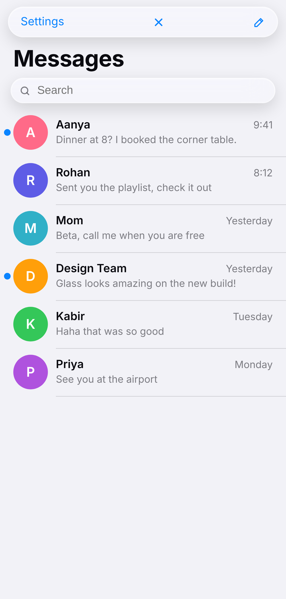 | 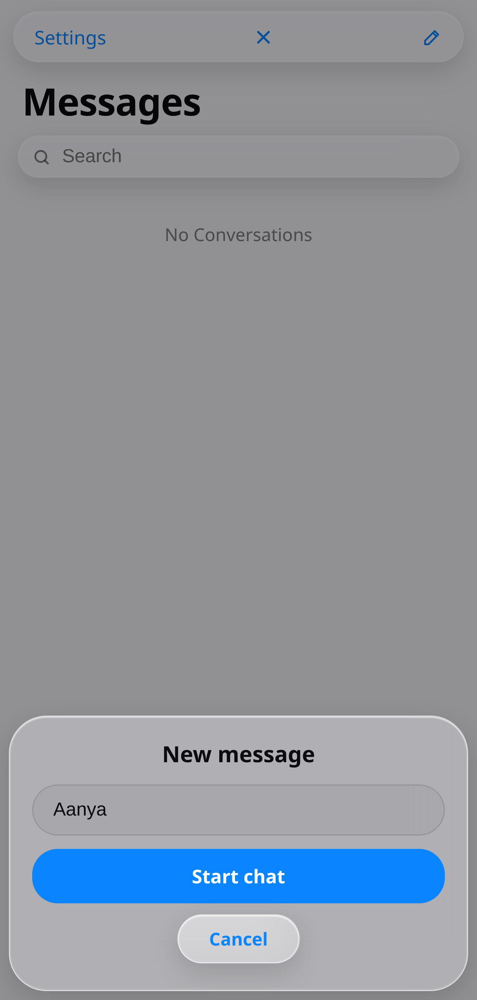 |

| Fresh conversation | Inbox after chatting |
|---|---|
| 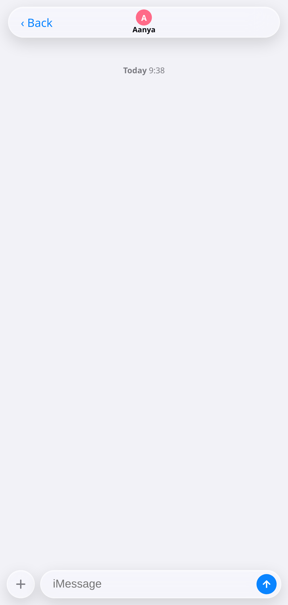 | 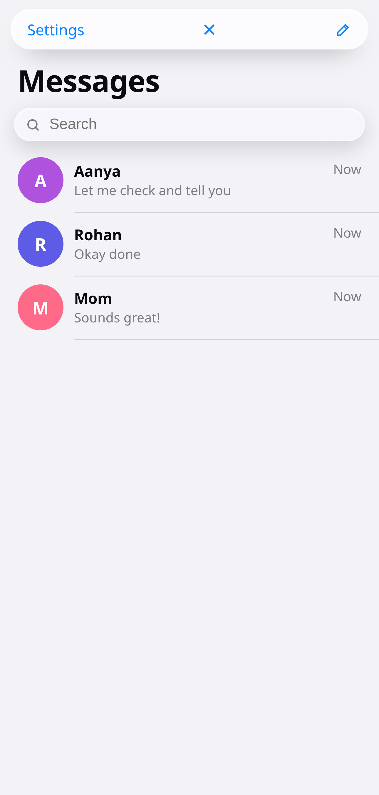 |

| Typing | Reply | Dark |
|---|---|---|
| 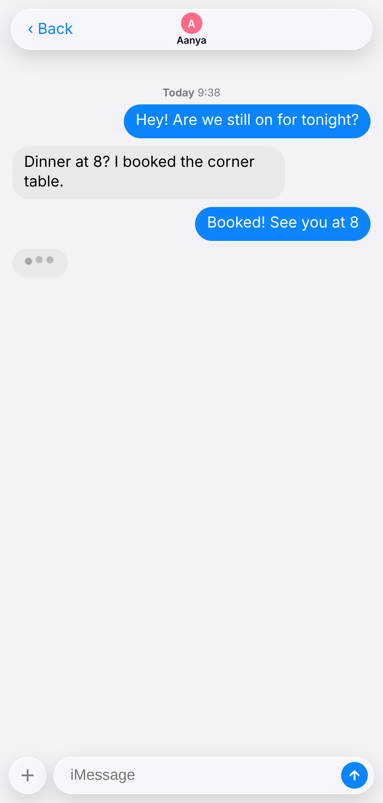 | 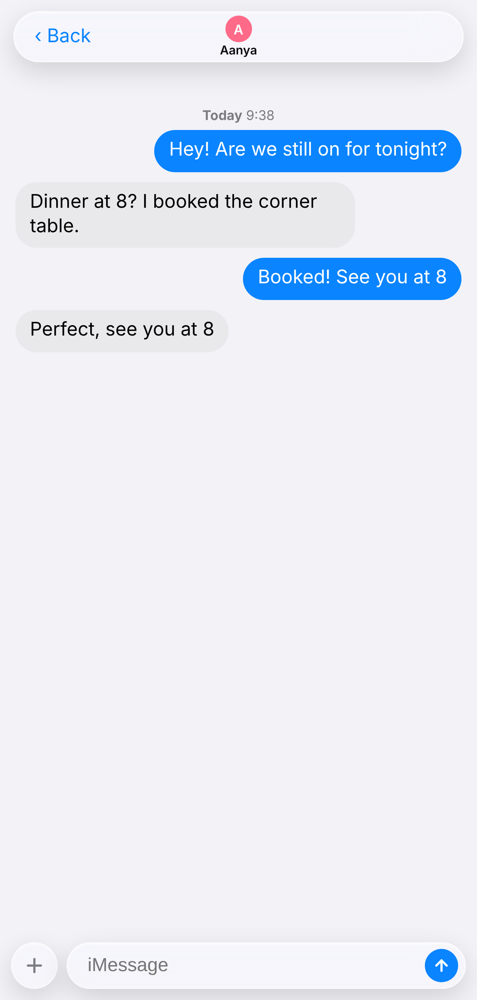 | 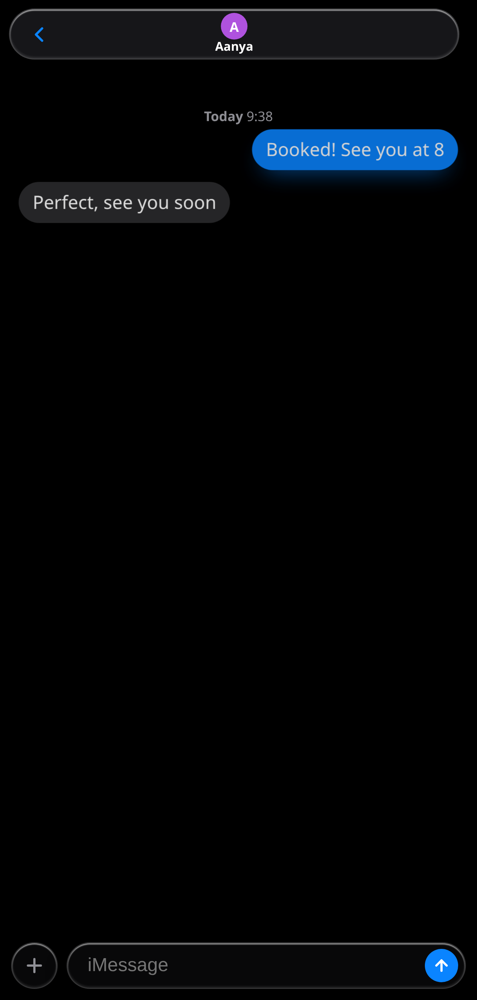 |

| Glass & Bounce settings | Long-press bubble |
|---|---|
| 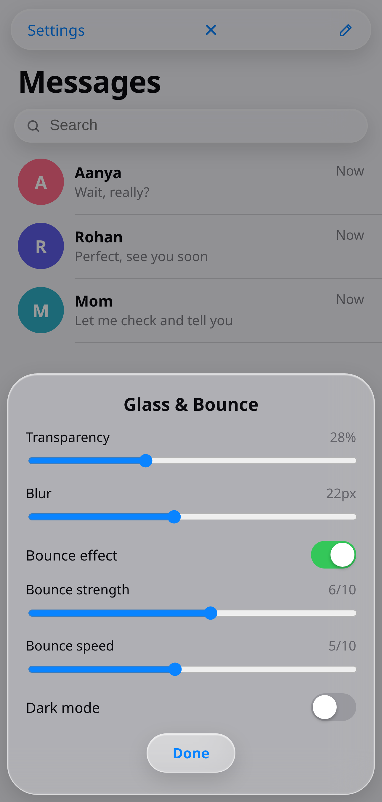 | 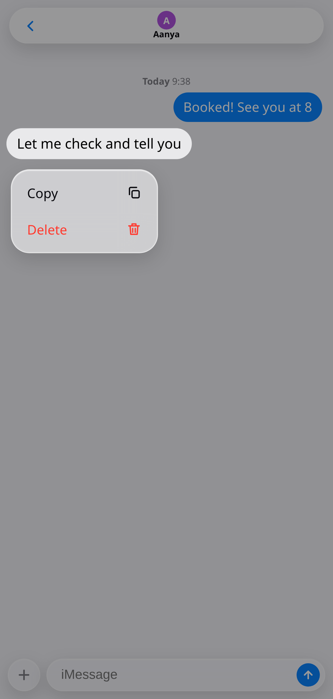 |

| Long-press conversation → delete | Default messaging app prompt | Pick a contact |
|---|---|---|
| 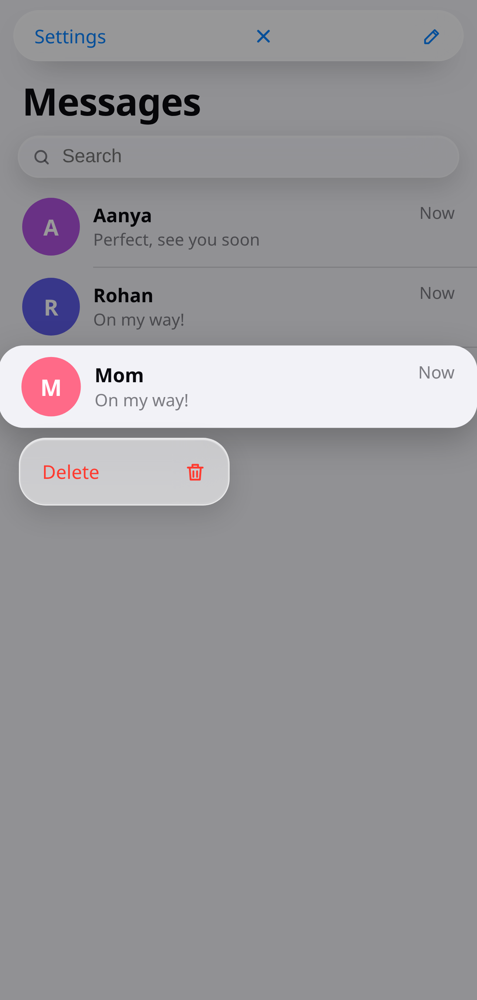 | 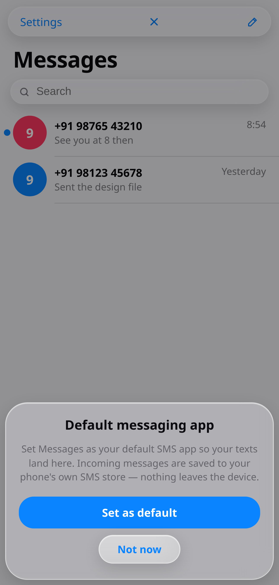 | 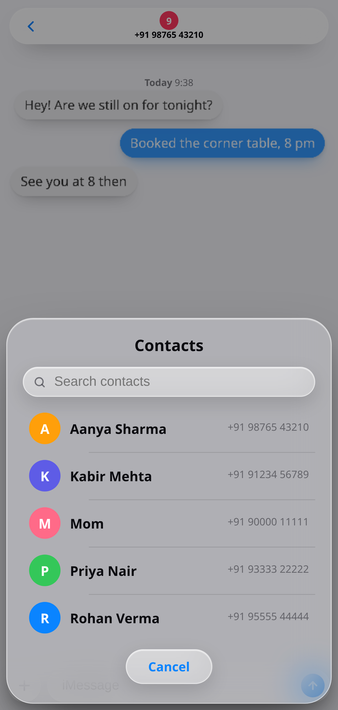 |

| 3D depth in a long thread — near bubbles lift, far ones recede |
|---|
| 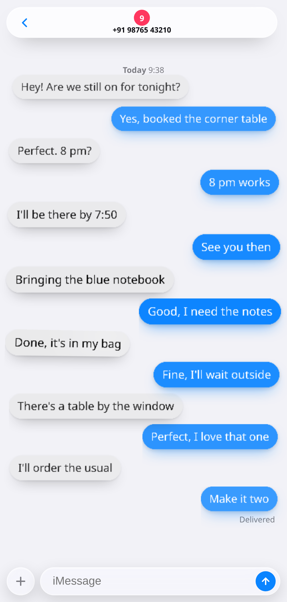 |

## Project layout

```
.
├── app/
│   ├── AndroidManifest.xml
│   ├── assets/index.html          # the entire UI (single file, no dependencies)
│   ├── res/
│   │   ├── values/                # strings, colors, theme
│   │   ├── drawable/              # adaptive icon foreground
│   │   └── mipmap-*/              # launcher icons
│   └── src/com/liquidglass/messages/MainActivity.java
├── build.sh                       # aapt2 → javac → d8 → zipalign → apksigner
├── screenshots/
└── apk/Messages-LiquidGlass.apk
```

## Build it yourself

Requirements: JDK 17, Android build-tools 34, platform `android-34`.

```bash
export JAVA_HOME=/path/to/jdk-17
export ANDROID_SDK=/path/to/android-sdk     # needs build-tools/34.0.0 + platforms/android-34
./build.sh
```

`build.sh` compiles resources with `aapt2`, compiles the single Java class against
`android.jar`, dexes with `d8`, aligns with `zipalign` and signs with `apksigner`.
It generates a local keystore on first run — **replace it with your own key before
publishing to the Play Store**, and **keep that key**: every release must be signed
with the same one, or Android refuses to install it over the previous build.

### Tests

`tests/` runs the bundled HTML in Chromium with a mocked Android bridge — no phone
needed.

```bash
npm install                       # playwright
node tests/ui-tests.js            # 68 behavioural checks
node tests/screenshots.js         # re-renders screenshots/
```

`ui-tests.js` covers boot, opening a thread, sending, delete + tombstones, the
poll/receive path, HTML escaping, settings persistence, the default-SMS flow, the
hardware-back chain and the 3D depth engine, and times a 300-message thread and a 300-conversation list. Many of
the checks are regressions from earlier releases: a poll must not drop a conversation
you just composed, composing an existing number must not clone it, an incoming message
must not rebuild the thread under an open long-press menu, pressing a bubble must not
flatten its depth for good, a draft must not follow you into the next chat, an unchanged
poll must leave the open thread (and its long-press menu) working, a broadcast that
changes nothing must repaint nothing, an incoming text must not rebuild the list under
an open conversation menu, and a number the store writes differently — with or without
its country code — must never close the open chat or clone it. A notification tap must
open the chat on top of a closed app or an open sheet, typing in the contacts search must
not re-query the provider, a send the radio refuses must give the text back, and a sheet reopened inside its own exit animation must stay up (it used to close itself and leave the scrim behind). A store rebuild must keep the open chat's messages (it used to collapse them to the one-line snippet, so a long-press deleted a different text), a chat deleted in another app must unwind instead of stranding the thread screen, and an *empty* store read must not — that is a provider hiccup, not a delete. The row markup cache must not change what is drawn (a new message renumbers every row, and a tap must still open the conversation it points at), and deleting a text and leaving the chat must leave no node behind with `visibility:hidden`. A slider must not turn "follow the phone" into a fixed theme, an incoming text must be appended to the open chat rather than repainted (the nodes already on screen have to survive, and the markup must match a full rebuild), and a text swapped in the *middle* of a conversation — same count, same tail, same snippet — must still reach the screen. A store query that throws must leave the conversation list and the open chat exactly as they were (an empty *result* is still empty; a *failure* is not), and a conversation arriving at the top must patch the list rather than rebuild it — the rows below have to be moved, not re-created, `data-i` has to follow them, and a tap on a moved row must still open its own chat. A row on screen must also carry the conversation's index in the full list, not its position among the matches: with a search filter active, a tap on the third match has to open that match (and a long-press on it has to delete that match), and the rows have to be re-pointed when a conversation above them is deleted. Sending a text must append it, not repaint the conversation. A second finger must release the control the first one was pressing, an `sms:` link or a notification tap over an open bubble menu must leave no scrim behind, a conversation deleted in another app while its menu is open must unwind the menu, its floating copy and the scrim, a keyboard send with a menu open must still draw its bubble, and a rotate must re-pose the depth for the new viewport. Chromium is recycled every 8 contexts, so a small machine does not run out of memory halfway through and kill the last check.

`ONLY=<substring>[,<substring>] node tests/ui-tests.js` runs just the matching
tests.

## What's new in 2.19 — the menu that would not let go

**Fixed**

- **A second finger left the first control shrunk.** The press bounce keeps the
  element it is animating in one slot (`pr`) so it can be restored on release. A
  second finger pressing anything else overwrote that slot without releasing the
  first element, and the control the first finger had been holding stayed at
  `scale(0.93)` for the rest of the session — a slightly smaller row, button or
  bubble that never came back. A new press now releases the previous one first.
  Two thumbs resting on the inbox while you tap a chat is enough to hit this.
- **A notification tap left the screen dimmed and unresponsive.** `__composeTo()`
  (the notification tap and the `sms:` link) dismissed an open long-press menu with
  `closeCtx()` — which removes the menu and its floating copy but not the scrim.
  The scrim stayed at `opacity:1` with `pointer-events:auto`, so the chat you were
  taken to sat under a dark overlay that swallowed every tap until you tapped the
  overlay itself. It now goes through `closeSheets()`, which is what already
  clears the scrim for the sheet path.
- **A chat deleted in another app stranded its menu over the inbox.** A poll that
  finds the open conversation gone calls `backThread()` — which slid the thread
  away and left the long-press menu, its floating bubble copy and the scrim
  hovering over the conversation list. `backThread()` now unwinds the menu too.
- **Sending from the keyboard while a menu was open lost the bubble.** The scrim
  only covers the page, not the keyboard, so the IME's send key still fired
  `sendMsg()` with a menu up — and `renderThread()` deliberately defers behind an
  open menu. The text went out over the bridge, the field was cleared, and nothing
  appeared in the conversation until the menu was dismissed. `sendMsg()` now
  dismisses the menu first so the send can paint.
- **Rotating the phone left every bubble in the old pose.** The depth engine
  measures each bubble against the scrollport height, and the resize handler
  cleared the geometry cache without ever re-posing: after a rotate, every bubble
  kept the `--bz`/`--by`/opacity it was given for the previous viewport until the
  reader scrolled. A resize now queues one depth pass.
- **Your own message could mark a conversation unread.** `threadsJson()` treated
  any row with `READ=0` as unread, including outgoing rows — an outbox, queued or
  failed row left `READ=0` by the provider put an unread dot on a conversation
  whose newest text you had just sent. Only `MESSAGE_TYPE_INBOX` rows count now.

**Optimised**

- **Deleting a long conversation no longer re-scans every tombstone for every
  message.** `LocalStore.tombstoneAll()` writes the whole tombstone array in one
  pass, but its duplicate check still walked that array once per message: deleting
  a 500-message thread against a full 3000-entry store was ~1.5 million JSON
  reads, on the JS bridge thread, with the page blocked waiting for the call to
  return. It indexes the existing tombstones once, exactly like `delIndex()` does
  for reads — O(rows × tombstones) becomes O(rows + tombstones).
- **Sending allocates less.** Three `[...document.querySelectorAll('#msgs .bub')]`
  spreads built an array of every bubble in the chat on each send (≈150 nodes on a
  300-message thread) just to take the last one. The `NodeList` is indexed
  directly.

**Harness**

- Five new checks, **68** in total: a second finger must release the first, an
  `sms:` link over an open bubble menu must leave no scrim, a chat deleted
  elsewhere while its menu is open must unwind the menu, the floating copy *and*
  the scrim, a keyboard send with a menu open must still show the bubble, and a
  rotate must re-pose the depth for the new viewport. All five fail on 2.18.

**Unchanged on purpose** — all 14 screenshots re-render to the same PNGs byte for
byte, so the UI, layout, colours, fonts, glass and depth pass are untouched. Still
open, each waiting on your call: `will-change` on every bubble (it cannot be
dropped without touching the base `translate3d` that gives bubbles their layer,
which is the 3D design), a very long conversation still painted in full the first
time it opens, the thread screen that stays up after an *empty* provider read, the
wallpaper-blob half of the parallax that the CSS parser still discards, and the
signing key (still not in the repository, so this APK will not install over 2.18 in
place — uninstall the old build first).

## What's new in 2.18 — the row that opened somebody else's chat

**Fixed**

- **Searching, then tapping a result opened the wrong conversation.** Since 2.17 the
  list is patched in place and each row carries `data-i`, the index a tap uses to find
  its conversation. That index was written as the row's position *among the matches*
  rather than its position in the full conversation list, and the two only agree when
  the search box is empty. Type `a` in a four-chat inbox where the third match is
  *Zoya*, tap it, and *Mom* opened. The index now travels beside the markup, so a row
  always points at the conversation it is showing.
- **…and long-pressing a result deleted the wrong conversation.** Same cause, worse
  outcome: the row menu looks its target up the same way, so deleting the third match
  removed whatever conversation sat at index 2. Filtered rows are the only place this
  could happen, which is why every unfiltered check passed.
- **A filtered row could keep pointing at a conversation that had moved.** The
  patched-list shortcut compares the markup it would write with the markup already on
  screen and does nothing when they match — but a row can move without a single
  character of it changing (a conversation above it, one that does not match the
  filter, is deleted). The comparison now includes the index, so those rows are
  re-pointed instead of silently going stale.
- **Deleting a conversation could leak a database cursor.** `tombstoneThread()` closed
  its cursor inside the `try`, so a provider that threw between the query and the read
  left it open — once per deleted conversation, on a phone where the SMS provider is
  already unhappy. `deleteMessage()` and `addrForThread()` were fixed this way years
  ago; this one was missed. It closes in a `finally` now.

**Optimised**

- **Sending no longer repaints the whole conversation.** `sendMsg()` called
  `renderThread()` with no `keepScroll`, which takes the full `innerHTML` path: on a
  300-message thread that is **~34 ms** of parse (measured) to add one bubble at the
  end, and it throws away every node in the chat — its depth pose, its press state, any
  animation on it. A send only ever appends, so it takes the append-only path that
  incoming texts have used since 2.16: **2.8 ms**, 12× less, and the nodes already on
  screen survive. The markup is byte-for-byte what the full rebuild writes (asserted by
  the harness), the thread still lands scrolled to the bottom, and anything the append
  path cannot prove is a pure append — a typing bubble, a model that does not match the
  screen — still falls back to the full rebuild.

**Harness**

- Four new checks, **63** in total: a filtered row must open the conversation it shows,
  a long-press on a filtered row must delete that conversation, rows must be re-pointed
  when a conversation above them is deleted, and a send must append rather than repaint
  (the nodes on screen have to survive, `data-i` has to stay in step, the markup has to
  match a full rebuild, and the thread has to end up at the bottom). All four fail on
  2.17.

**Unchanged on purpose** — all 14 screenshots re-render to the same PNGs byte for byte,
so the UI, layout, colours, fonts, glass and depth pass are untouched. Still open, each
waiting on your call: `will-change` on every bubble (it cannot be dropped without
touching the base `translate3d` that gives bubbles their layer, which is the 3D design),
a very long conversation still painted in full the first time it opens, the thread
screen that stays up after an *empty* provider read, the wallpaper-blob half of the
parallax that the CSS parser still discards, and the signing key (still not in the
repository, so this APK will not install over 2.17 in place — uninstall the old build
first).

## What's new in 2.17 — the list that rebuilt itself for one row

**Fixed**

- **One failed SMS query could wipe the screen.** Both store readers swallow a provider
  exception and return `[]`, and the page cannot tell that apart from a genuinely empty
  phone: a single bad query repainted an empty *No Conversations* list over 300 real
  conversations, or emptied the open chat down to its date stamp. They answer `null`
  now — "I could not read it" — and the page keeps whatever it is already showing, the
  same rule the store rebuild has used since 2.13. An empty *result* still counts as
  empty; only a failure is ignored.
- **A quick reply from the notification shade did not show up.** `HeadlessSmsSendService`
  writes the text to the store but never told the page, so the reply you just sent from
  the shade stayed invisible until the next 6-second poll. It broadcasts the same
  "store changed" signal the in-app send path does.
- **Deleting a conversation left its notification behind.** Tapping that notification
  then opened a chat that no longer exists. Deleting the thread clears it, exactly like
  reading it does.
- **The no-bridge send path animated the wrong node.** The fallback reply path (a browser
  without `window.Android`) picked its bubbles with `document.querySelectorAll('.bub.me')`.
  The long-press menu's floating copy keeps that class and sits later in the document, so
  `.pop()` returned the ghost and the pop-in ran on a node nobody was looking at. The
  three lookups are scoped to `#msgs`.
- **A typing bubble could outlive the message that replaced it.** The append-only
  repaint removed the *Delivered* marker but not the three dots, so a thread that had one
  could show the new text above dots that never went away. The append path clears both.
- **A finished page resurrected a dead shell.** `onDestroy()` loads `about:blank` into
  the WebView it is tearing down; that load finished afterwards and set `pageLoaded` back
  to `true` on an activity with no view.

**Optimised**

- **The conversation list is patched, not re-parsed.** Any change to the list handed all
  of `#rows` back to the HTML parser. That includes the commonest event in the app — a
  text arriving — because the row index (`data-i`, how a tap finds its conversation) is
  baked into the markup, so one new conversation at the top renumbered and re-parsed
  every row below it. The index is now written onto the node instead of into the cached
  string, and only the rows that really differ are created, moved or removed. On a
  300-conversation store, one arrival went from **41.9 ms to 5.0 ms**, and the nodes
  already on screen survive. The markup is byte-for-byte what the full rebuild writes,
  and `data-i` is re-stamped on every row it walks, so taps and long-presses still land
  on the conversation under your finger — including two conversations whose markup is
  identical.
- **The address book no longer recompiles a regex per contact.** `contactsJson()` ran
  `number.replaceAll("[^0-9+]", "")` on every row of up to 1000 — a fresh `Pattern`
  compile each time. It is compiled once.

**Harness**

- Four new checks, **59** in total: a failed thread query must not empty the list, a
  failed message query must not blank the open chat, a new conversation on top must
  patch the list (the rows below must be *moved*, not rebuilt, `data-i` must follow
  them, and tapping a moved row must still open its own conversation), and a
  300-conversation list must update for much less than a full rebuild. All four fail on
  2.16.

**Unchanged on purpose** — all 14 screenshots re-render to the same PNGs byte for byte,
so the UI, layout, colours, fonts, glass and depth pass are untouched. Still open, each
waiting on your call: `will-change` on every bubble (it cannot be dropped without
touching the base `translate3d` that gives bubbles their layer, which is the 3D design),
a very long conversation still painted in full the first time it opens, the thread
screen that stays up after an *empty* provider read, the wallpaper-blob half of the
parallax that the CSS parser still discards, and the signing key (still not in the
repository, so this APK will not install over 2.16 in place — uninstall the old build
first).

## What's new in 2.16 — the chat that only half-repainted

**Fixed**

- **A text deleted from the middle of a conversation stayed on screen.** The app only
  re-read the open chat when the *conversation list* moved, and a list row is just a
  snippet and a date — the newest text. Delete an older text in another SMS app and
  neither changes, so the poll returned early and the chat kept showing a text that no
  longer exists. The open chat is re-read on every poll now; a poll that really changed
  nothing still repaints nothing, because the signature is compared before anything is
  written.
- **The screen and the messages behind it could drift apart.** That same check
  (`threadSig`) looked only at the message *count* and the *last* bubble. One text gone
  and one text added in the same read leaves both identical while the middle has moved,
  so nothing repainted: the bubbles on screen no longer lined up with the array behind
  them, and the next long-press deleted a different text than the one under your
  finger. The signature now folds in every message (id, date, direction and text), one
  multiply-add each — about 0.02 ms on a 300-message thread.
- **One settings change froze the theme for good.** The theme was written to the store
  as a resolved `light`/`dark` value on every save, so moving *any* slider turned
  "follow the phone" into a fixed choice — the app stopped following the system from
  then on. It is only stored once you actually pick a side now, and while it is left to
  the phone the switch keeps up with the system instead of showing a stale position.
- **One malformed row could empty the conversation list.** The list was emptied and
  refilled row by row, so a store row with a null address (or a snippet that is not a
  string) threw halfway through the rebuild: the error was swallowed and the list was
  left truncated, with the open chat pointing past its end. The rows are built into a
  fresh array and swapped in at the end, and the avatar colour/initial helpers now
  accept a non-string.
- **Contacts could come back empty with the permission granted.** The contacts query
  carried `LIMIT 1000` inside its sort order. The contacts provider appends its own
  limit, and the builds that reject a second one threw — into a silent `catch` — so the
  sheet said "Contacts access is off" while `READ_CONTACTS` was held. The cap is in the
  loop, where it already was.
- **Deleting a text could leak a cursor.** `deleteMessage()` closed its cursor inside
  the `try`; a provider that threw between the query and the read left it open. It is in
  a `finally` now.
- **Two conversations could share one notification.** The per-conversation notification
  id used 16 bits of the address hash; the second sender's notification replaced the
  first. It uses 24 bits.

**Optimised**

- **An incoming text no longer repaints the conversation.** Every poll that brought a
  new text rebuilt all of `#msgs` with `innerHTML`, throwing away every bubble node —
  its depth pose, its press state, any animation on it — to add one line at the end.
  When nothing but the tail has changed, only the new bubbles are written. On a
  300-message thread, one incoming text went from **22.8 ms to 2.2 ms** (median, 8
  runs), and a whole poll-with-new-text from **19.9 ms to 5.6 ms**. The markup produced
  is exactly what a full rebuild writes — the harness checks that the nodes already on
  screen survive *and* that the result matches a full rebuild.

**Harness**

- Three new checks, **55** in total: a slider must leave the theme following the phone,
  an incoming text must be appended rather than repainted (node identity *and* markup),
  and a text swapped in the middle of a conversation must reach the screen. All three
  fail on 2.15's HTML.

**Unchanged on purpose** — all 14 screenshots re-render to the same PNGs byte for byte,
so the UI, layout, colours, fonts, glass and depth pass are untouched. Still open, each
waiting on your call: `will-change` on every bubble, a very long conversation still
painted in full the first time it opens, the thread screen that stays up after an
*empty* provider read, and the signing key (not in the repository, so this APK will not
install over 2.15 in place — uninstall the old build first). New this release: the
wallpaper-blob half of the parallax is still written and still discarded by the CSS
parser (the drift animation owns the transform) — repairing it would make the wallpaper
slide as you tilt the phone, which is a motion change that needs your sign-off.

## What's new in 2.15 — the text that vanished, the delete that stalled

**Fixed**

- **A text you sent could disappear from its own conversation.** When the phone's
  SMS store refuses our write (you have not granted the default-SMS role yet) the
  app keeps its own copy of the outgoing text, and the thread is rebuilt from both
  sources with a duplicate check. That check matched on the *text* and a **three
  minute** window — and it ignored which way the message went. So an outgoing
  *"ok"* was matched against an incoming *"ok"* from up to three minutes earlier,
  and the bubble you had just sent was dropped on the next poll. It now compares
  direction as well, and the window is 5 s: the only thing it has to absorb is the
  store rounding the timestamp of the row we wrote ourselves, exactly the reasoning
  that shrank the duplicate and tombstone windows in 2.13 and 2.14.
- **Deleting a long conversation froze the app.** Every message in the thread was
  tombstoned with its own call, and each call re-read and rewrote the *entire*
  tombstone list (up to 3000 entries) — a 500-message thread meant 500 full parses
  and 500 preference commits, on the bridge thread, with the page blocked waiting
  for the call to return. The rows are collected first and written in one go now.
- **Closing the app leaked its renderer.** The WebView was destroyed while it was
  still attached to the window, which keeps the renderer process, the JavaScript
  bridge and (through it) the Activity alive. It is detached and its bridge removed
  before `destroy()`.
- **A notification could be swallowed.** The "never notify twice for one SMS" guard
  — there to absorb the two broadcasts that can both fire for a single text — held
  for four seconds, so the same sender sending the same words twice in a row
  produced one notification. The two broadcasts arrive milliseconds apart; the
  window is 1.5 s.
- **A deleted bubble could stay invisible for good.** Long-press hides the real
  bubble while the floating copy is measured over it, and the copy's path is the one
  that puts it back. Delete a text and leave the chat before the collapse animation
  ends and the re-render that would have replaced the node never ran: the bubble
  stayed `visibility:hidden` in the DOM. The delete paths now restore it themselves.
- **Sent texts had no `DATE_SENT`.** The incoming path writes both dates; the
  outgoing one only wrote `DATE`, so a sent row had no time for another SMS app (or
  the provider's sent folder) to sort by.

**Optimised**

- **The conversation list is built once per row, not once per keystroke.** Typing in
  the search field rebuilt every row from scratch: an intermediate `{thread, index}`
  object per conversation, three passes over the list, and `esc()` + `ini()` + the
  name hash again for every match — on every letter. Each row's markup is now
  memoised on the thread object and reused until something about that conversation
  actually moves (the cache key carries the row index, because a new message at the
  top renumbers every row below it). Measured with 300 conversations: the markup
  build went from **2.9 ms to 1.5 ms** per render. The rest of `renderRows()` is the
  `innerHTML` re-parse of ~62 KB (~14 ms), which this does not touch — see below.

**Harness**

- Two new checks, **52** in total: the row-markup cache must never change what is
  drawn (a new message renumbers every row, and a tap must still open the
  conversation it points at), and deleting a text and leaving the chat must leave no
  node behind with `visibility:hidden`. Both fail on 2.14's HTML.

**Unchanged on purpose** — the frames are byte-for-byte identical: all 14
screenshots re-render to the same PNGs, and the UI, motion, glass and depth pass are
untouched. Still open, each waiting on your call: `will-change` on every bubble, a
very long conversation still painted in full, the thread screen that stays up after
an *empty* provider read, and the signing key (not in the repository, so this APK
will not install over 2.14 in place — uninstall the old build first). New this
release: replacing the list with a keyed diff instead of a full `innerHTML` write
would take the remaining ~14 ms out of a search keystroke, but it rewrites the row
plumbing the long-press menu is anchored to, so it is reported rather than shipped.

## What's new in 2.14 — the unread dot that would not go away

**Fixed**

- **A text that arrived in the chat you were reading came back as unread.** The app
  marks a conversation read when you *open* it, and the store was never told again —
  so an SMS that landed while that conversation was on screen left the store's unread
  flag set. The moment you went back, the row you had just read grew an unread dot,
  and it stayed there until you opened that chat a second time. A message that arrives
  in the conversation on screen is now marked read (and its notification cleared) as
  soon as it lands, which is what the native side already does for an opened chat.
- **Deleting a text could silently swallow the next one.** Tombstones matched a
  deleted message on address + body inside a three-minute window. If the same person
  sent the same words within three minutes of a delete — *"ok"*, a station name, an
  OTP-style code — the new message matched the tombstone and never appeared: the
  delete ate a message that had nothing to do with it. A tombstone records the exact
  date of the row that was deleted, and a re-read of that same row carries exactly
  that date, so the window only has to absorb a provider that rounds the timestamp
  (5 s now, the same reasoning that shrank the duplicate window in 2.13). Messages
  already deleted stay deleted.
- **The Bounce-strength label disagreed with its own switch.** With the bounce off,
  dragging the strength slider printed `8/10` under a toggle that said *Off*; the
  label now reads *Off* until the bounce is back on.

**Optimised**

- **The parallax bars are not re-styled when their pose has not changed.** The
  gyroscope reports on every frame even when the handset is lying still, and a style
  write on a `backdrop-filter` bar makes the compositor re-blur the wallpaper behind
  it. The value written is unchanged, so this is invisible: measured in the browser,
  120 still-handset frames went from **120 style writes to 1**, and a moving handset
  skips the frames that round to the pose already applied.

**Harness**

- **The long-press checks flaked on a loaded machine.** They measured the bubble
  straight after tapping the row, while the thread was still sliding in (a 750 ms
  transition), so the press landed on a moving target and the context menu never
  opened. `threadSettled()` now waits for the push transition to finish. This was a
  harness bug, not an app bug — the same test failed on 2.13's HTML when the box was
  busy.
- `ONLY=` takes a comma-separated list, so the suite can be run in chunks on a slow
  machine, and it is **50 checks** now (the unread dot and the bounce label above are
  both covered).

**Unchanged on purpose** — the frames are byte-for-byte identical: all 14
screenshots re-render to the same PNGs, and the whole UI, motion, glass and depth
pass are untouched. Still open from 2.13, each waiting on your call: `will-change` on
every bubble, a very long conversation still painted in full, the thread screen that
stays up after an *empty* provider read, and the signing key (not in the repository,
so this APK will not install over 2.13 in place — uninstall the old build first).

## What's new in 2.13 — the chat that forgot its own messages

**Fixed**

- **A long-press could delete a different message than the one you pressed.**
  The conversation list is rebuilt from the SMS store on every poll, and a store row
  carries only the *one-line snippet* — the real message array lives in memory. The
  rebuild threw that array away and put the snippet in its place, so the screen kept
  showing every bubble while the array behind it held a single fake one. Every caller
  reloads the open chat immediately afterwards, which is why it was invisible in
  normal use, but when that reload failed (a bridge hiccup, a malformed store read)
  the damage stayed: the next long-press on any bubble opened Copy/Delete for
  whatever sat at that index, and Delete removed the wrong text. The open chat's
  messages now survive the rebuild, so the invariant no longer depends on the caller.
- **A conversation deleted in another app stranded you inside it.** The thread screen
  stayed up with stale bubbles, the list stayed pushed off-screen, and the composer
  silently did nothing at all — `cur` was already `null`, so `sendMsg()` returned
  before it sent anything. The thread now unwinds back to the list the way the back
  button would. It only unwinds when the store still lists conversations: an empty
  read is a provider hiccup, not a delete, and must not throw you out of a chat.
- **Answering a permission dialog asked the system twice.** `onRequestPermissionsResult`
  evaluated `__onSmsStatus` twice, so every permission answer ran two `RoleManager`
  queries and two JS bridge round-trips for one result. One push now.

**Optimised**

- **The depth pass only poses the bubbles that can be seen.** `depthScroll()` used to
  compute and write a transform for all 300 bubbles of a long thread on every scroll
  frame, most of them clipped away outside the scrollport. A bubble more than half a
  viewport outside the visible band keeps the pose it already has — its few tens of
  pixels of Z and Y cannot pull it back into view — and is recomputed the moment it
  scrolls into range. On a 300-message thread that is **21.7 ms → 6.5 ms** per scroll
  frame (median of seven, software GL) and **9.7 ms → 0.3 ms** for a full pass that
  writes every bubble, which is what a scroll actually costs. Frames are unchanged:
  all 14 screenshots, and a 60-message thread captured mid-scroll at three scroll
  offsets, come out byte-for-byte identical before and after.

**Corrected notes**

- The comment above the parallax code claimed neither the bars nor the wallpaper move,
  because the bar string is missing its closing parenthesis. Measured in the browser:
  the CSS parser closes that paren itself, so the two bars **do** slide with the
  pointer and the gyroscope (`translate3d(6.3px,-1.8px,0)` really lands), while the
  wallpaper blobs do not, because the infinite `drift` animation owns their transform
  and overrides the inline one — which is exactly why `parBlobLive` turns that write
  off. The comment now says so; no behaviour changed.
- **The screenshot harness needed a longer per-page timeout.** Rendering a phone-sized
  page with live `backdrop-filter` blur on software GL takes longer than 6 s on a small
  machine, so `node tests/screenshots.js` died on the first frame. It is 20 s now, and
  the render is reproducible: every frame matches the committed PNG byte for byte.

**Reported, not patched** (each would change the approved design or needs your decision)

- **`will-change: transform` is still on every bubble** (300 compositor layers on a
  300-message thread). Removing it would cut GPU memory, but it could change how the
  depth repaints on a low-end phone — still waiting on your sign-off.
- **A very long conversation is still rendered in full.** The per-frame cost is now
  proportional to what is on screen, but the first paint of 300 messages is still
  ~100 ms of layout. A windowed list (or a *load earlier* affordance) would fix it and
  changes what is on screen.
- **The Bounce-strength label still reads "6/10" if you drag the slider while the
  bounce toggle is off** — the toggle itself correctly says *Off*, the label does not.
- **An empty provider read still leaves the thread screen up.** That is deliberate (see
  above): closing the chat on a hiccup would be worse than showing it a moment longer.
- **The signing key is not in the repository**, so this APK will not install over 2.12
  in place: uninstall the old build first (see *Download & install*).

## What's new in 2.12 — the sheet that closed itself

**Fixed**

- **Dismissing a sheet and reopening it quickly made it vanish, with the scrim left
  behind.** A sheet's exit animation runs for ~400 ms and the scrim is dropped the
  instant you tap *Done*, so the gear is already live while the sheet is still sliding
  away. Opening it again inside that window added `.on` — and the *old* exit animation
  then finished and took `.on` straight back off. The sheet disappeared and the scrim
  stayed up over an empty screen, swallowing every tap until you tapped the scrim to
  clear it. `sheet()` and `closeSheets()` now share one generation counter (the same
  pattern `openApp`/`closeApp` and the context menu already used) and a reopened sheet
  cancels the stale exit animation. It was one shared helper, so every sheet — settings,
  new message, contacts, default-app — had it.
- **The same class of bug in the long-press menu with the bounce effect off.** With
  bounce disabled `hideMenu()` removed `.on` synchronously and never touched the
  generation counter, so a hide that had started before you switched bounce off could
  still complete afterwards and close a menu you had reopened since.
- **Repeated closes stacked exit animations on one sheet.** Each close now cancels the
  previous exit animation before starting its own, so only the newest one can finish.

**Optimised**

- **`esc()` is one pass** with a lookup table instead of four chained `replace()` calls.
  It runs for every bubble, row and contact on every render.
- **The contacts list only rewrites `#clist` when the filtered markup actually
  changes.** Typing a letter that cannot narrow the list any further no longer throws
  away and rebuilds up to 200 rows (with their avatars) for nothing — the same
  string-compare the conversation list has used since 2.10.
- **The Depth slider coalesces into one pass per frame.** Dragging it ran the full depth
  pass for every `input` event, ~3.5 ms per pixel of travel on a 300-bubble thread; it
  now runs once per animation frame, which is the only rate the screen can show.
- **The parallax frame no longer allocates.** The pointer and the gyroscope hand their
  coordinates over in two scalars instead of a fresh `[x, y]` array per event, on a path
  that a sensor can drive at 100 Hz.
- **The browser harness recycles Chromium every 8 contexts.** On a machine with ~2 GB of
  RAM the browser process was OOM-killed after roughly forty contexts, which killed the
  *last* check with *"target page, context or browser has been closed"* and made a
  green suite look flaky. 45/45 now passes reliably, and a render of a 300-message
  thread measures ~78 ms with the depth pass at ~4 ms/frame.

**Reported, not patched** (each would change the approved design or needs your decision)

- The bar/blob parallax string is still missing its closing parenthesis and the wallpaper
  blobs are still driven by the `drift` animation, so the bars and the wallpaper still do
  not slide on tilt. That is a motion change, so it stays exactly as approved.
- **`will-change:transform` is still on every bubble** (300 compositor layers on a
  300-message thread). Removing it would cut GPU memory, but it could change how the
  depth repaints on a low-end phone — still waiting on your sign-off.
- **A very long conversation is still rendered in full.** 300 messages cost ~78 ms of
  layout; a few thousand would crawl. A windowed list (or a *load earlier* affordance)
  would fix it, but it changes what is on screen.
- **The Bounce-strength label reads "6/10" if you drag the slider while the bounce
  toggle is off** — the toggle itself correctly says *Off*, the label does not.
- **The signing key is not in the repository**, so this APK will not install over 2.11 in
  place: uninstall the old build first (see *Download & install*).

## What's new in 2.11 — the chat opens where you can see it

**Fixed**

- **Tapping a notification (or an `sms:` link) for a chat that already existed opened it
  behind a closed app.** `__composeTo` only slid the thread in; it never brought the app
  itself on screen, so the springboard stayed in front and the conversation was running
  invisibly behind it. A new number worked, which is why this survived — the bug was on
  the existing-conversation branch only. The app is now raised first, then the chat.
- **The same tap could land behind an open sheet or a long-press menu.** An `sms:` link
  from contacts, the dialer or a notification while the Settings sheet was up put the chat
  underneath it, with the scrim still swallowing every touch. Both are dismissed first.
- **A send the radio refused still looked sent.** `sendSms` answers `false` when the
  message cannot go out (no service, invalid address, provider exception); the page
  ignored the answer, kept the bubble, cleared the field and dropped the text. The
  optimistic bubble is now rolled back and the text is put back in the composer.
- **A conversation you had read came back unread.** While the app is not the default SMS
  app the provider refuses our `READ` write, so the unread dot returned on the next poll.
  `read_at` was also matched by exact address, so a text stored as `+919876543210` and a
  thread the store spells `+91 98765 43210` never matched at all — that conversation kept
  its dot forever. The list now consults `read_at` through the same normalised comparison
  the rest of the store uses, and a thread older than the last time it was opened is
  always read.
- **Tapping an MMS notification did nothing.** The notification had no content intent.

**Optimised**

- **The contacts search re-queried `ContactsContract` on every keystroke.** Each letter
  typed in the contacts field ran a fresh `loadContacts()` — a full provider query over up
  to 1000 rows and every phone number — on the bridge thread, and then filtered the same
  list again. The list is now fetched once per sheet open (and once more only if the
  permission result arrives) and filtered in place: 4 keystrokes went from 4 provider
  queries to 0.
- **The contacts query itself is bounded.** `ContactsContract` now returns at most 1000
  rows; the Java loop already stopped there, so the provider was doing the extra work for
  nothing.
- **`read_at` is indexed once per poll.** The thread list derives its normalised index from
  the single `read_at` parse it already did, instead of looking keys up by exact string.

**Reported, not patched** (each would change the approved design or needs your decision)

- The bar/blob parallax string is still missing its closing parenthesis and the wallpaper
  blobs are still driven by the `drift` animation, so the bars and the wallpaper still do
  not slide on tilt. That is a motion change, so it stays exactly as approved.
- **`will-change:transform` is still on every bubble** (300 compositor layers on a
  300-message thread). Removing it would cut GPU memory, but it could change how the
  depth repaints on a low-end phone — still waiting on your sign-off.
- **The signing key is not in the repository**, so this APK will not install over 2.10 in
  place: uninstall the old build first (see *Download & install*).

## What's new in 2.10 — the list stops moving under your finger

**Fixed**

- **The conversation list rebuilt itself under an open long-press menu.** A poll or an
  incoming text that landed while a conversation's menu was open re-wrote `#rows`, which
  replaced the very row the menu was anchored to: its floating copy then sat over a
  duplicate of itself, and the row that had been pressed was no longer in the list. The
  rebuild is deferred until the menu closes, the way the open thread already was, and a
  delete now resolves its row through the same normalised lookup as everything else
  instead of an exact address compare.
- **Every SMS broadcast rebuilt the open chat and the whole list, changed or not.**
  `__onSmsChanged` fires for a role grant, an MMS notice and a text in a conversation you
  are not even looking at. Each one re-rendered up to 300 bubbles, reset the depth cache,
  killed any pop animation in flight and threw away every row node. It now repaints the
  thread only when its contents actually differ and lets `loadThreads()` decide about the
  list.
- **Composing a bare number cloned a contact stored with its country code.** Typing
  `9876543210` for a chat the store holds as `+919876543210` created a second,
  local-only conversation. The page now drops the Indian country code before comparing,
  exactly like the native store already did.
- **A deleted text could come back as a conversation's snippet.** The thread list never
  consulted the tombstone store, so a delete the provider refused (no default-SMS role)
  reappeared in the list on the next poll with the deleted text under the name. The list
  now skips tombstoned rows and falls back to the previous live message.
- **A damaged preference could flatten the whole 3D scene.** A stored value that was not
  a number turned the depth maths into `NaN` and pushed every bubble to `"NaNpx"`. Slider
  values are read through a guarded parse.
- **A stale row index could throw.** `openThread()` now checks the conversation still
  exists before writing to it.

**Optimised**

- **The parallax stopped writing styles the cascade throws away.** The wallpaper blobs are
  driven by the infinite `drift` animation, which overrides any inline transform, and the
  bar transform string is invalid — two dead style writes per parallax frame, on every
  pointer move and every gyroscope sample. Both are now detected once and skipped. Motion
  is unchanged (they never applied); the work is gone.
- **The list is only re-written when its markup changes**, instead of on every poll and
  every keystroke in the search field.
- **The refresh after a send re-renders only if the conversation changed**, rather than
  rebuilding the whole thread 900 ms after every message.

**Reported, not patched** (each would change the approved design or needs your decision)

- The bar/blob parallax transform string is still missing its closing parenthesis, so the
  bars still do not slide on tilt. Repairing it is a motion change; it stays as approved.
  The 2.10 change above only stops paying for the write.
- **`will-change:transform` is still on every bubble.** On a 300-message thread that asks
  the WebView for 300 compositor layers; dropping it would cut GPU memory but could change
  how the 3D depth repaints on a low-end phone, so it needs your sign-off.
- **The signing key is not in the repository** (`.gitignore` excludes `*.keystore`), so
  this build is signed with a key generated during the build and will not install over
  2.9 — uninstall first. See the note under *Download & install*.

## What's new in 2.9 — the 6-second poll stops breaking the open chat

**Fixed**

- **Long-press stopped working in a chat you had left open.** Every poll rebuilt the
  conversation list from the store, which replaced the open thread's message array with
  its one-line snippet while the bubbles stayed on screen. The next long-press looked for
  the message at that index, found nothing, and the copy/delete menu silently refused to
  open. Sending in that state also drew the snippet back as a phantom received bubble
  above your text. The list is now only rebuilt when the store actually changed.
- **An open chat could close itself.** When the store handed the same conversation back
  with the number written differently (`+91 98765 43210` vs `+919876543210`), re-pointing
  the open thread used an exact address compare, failed, and dropped you back to the list
  — where the next Send did nothing. It matches the number the way the rest of the app
  does.
- **Picking a contact (or arriving on an `sms:` link) cloned a conversation** whose
  number is stored in another format. Both paths now resolve the address through the same
  normalised lookup as compose.
- **The unread dot could be missing on a conversation that had unread texts.** Only the
  newest row of each thread was inspected, so a chat whose latest message you had read
  but which still held unread older ones looked read. The flag now folds in every scanned
  row of the thread.
- **A repeated text could be swallowed.** The backup store treated an identical body from
  the same sender within three minutes as a duplicate — texting "ok" twice in two minutes
  kept only one copy. The window is now five seconds, which is all the two receivers
  firing for a single SMS need.
- **A menu could close the one that replaced it.** A hide animation still in flight
  removed `.on` from a menu that had been reopened in the meantime; the open/close pair
  now share a counter, like the app open/close pair already did.

**Optimised**

- **The poll no longer re-renders an unchanged thread.** `window.__onSmsPoll` reloaded and
  re-rendered the open conversation every six seconds even when nothing had arrived — a
  full `innerHTML` rebuild plus relayout of up to 300 bubbles, and it reset the depth
  cache and any pop animation in flight. It now returns as soon as the store signature is
  unchanged, and `loadThreads()` no longer throws away the open thread's messages on a
  no-op poll.
- **`depthScroll()` stopped allocating per frame.** It built a fresh `Array(n)` on every
  scroll frame (300 allocations a frame on a long thread) and re-queried `#tscroll`; both
  are reused now. Still 2.4–3.4 ms/frame over 300 bubbles.
- **Dragging the depth sliders no longer hammers storage.** Each input event wrote all ten
  preferences; the depth, parallax and tilt sliders now go through the existing 300 ms
  debounce.
- A 300-message thread still renders in 36–63 ms.

**Reported, not patched** (each would change the approved design or needs your decision)

- The bar/blob parallax transform string is still missing its closing parenthesis and the
  blob transform is still overridden by the infinite drift animation, so neither the bars
  nor the wallpaper move on tilt. Repairing it is a motion change, so it stays as
  approved.
- **The signing key is not in the repository** (`.gitignore` excludes `*.keystore`), so
  this build is signed with a key generated during the build and will not install over
  2.8 — uninstall first. See the note under *Download & install*.

## What's new in 2.8 — the draft stays put, the depth comes back

**Fixed**

- **A draft followed you into the next conversation.** The composer is one field for
  every chat, and opening a thread never cleared it: type half a message to one person,
  go back, open another chat, tap Send — and it went to the wrong person. The field is
  now cleared when you switch conversations (opening the same chat again keeps it).
- **Pressing a bubble flattened its depth for good.** Pressing a bubble tilts it toward
  your finger and clearing that pose wrote the depth variables back to zero, but the
  per-bubble depth cache still held the old signature, so `depthScroll()` skipped it and
  the bubble stayed flat until you scrolled. The cache is dropped with the pose.
- **A deleted local-only conversation could come back.** Deleting a chat that only
  exists in the app's own store swept the backup copies by exact address, while
  everything else matches the number normalised (`+91 98765 43210` = `+919876543210`).
  The other spelling survived, so the row reappeared on the next poll. The delete path
  now matches like everything else and tombstones each copy under its own address.
- **A deleted message could be merged back in.** `messagesJson()` checks tombstones with
  the address; a caller that passed only a thread id handed it `null` and every tombstone
  check returned "not deleted". The address is now resolved from the thread id.
- **Notifications could vanish entirely on Android 8+.** Both channels shared one
  "already created" flag, so whichever was created first blocked the other — and posting
  to a channel that does not exist throws, which the surrounding `catch` swallowed. One
  flag per channel now.
- **Tapping an older message notification opened the wrong chat.** Every notification
  reused one `PendingIntent` request code, so `FLAG_UPDATE_CURRENT` left them all
  pointing at the last conversation. One request code per conversation.
- **Incoming texts never reached the system SMS store on Android 7–9.** The receiver
  wrote the `seen` column, which only exists from Android 10, so the insert failed on
  every message and the text only survived in the app's own backup copy. The column is
  written on Android 10+ only (the read path already did this).
- **Closing the app and reopening it quickly left it closed.** The close animation's
  completion removed `.on` even if a reopen had started in between; both paths share a
  counter now and only the newest one acts.
- **Jumping straight from one chat to another re-ran the push animation.** Picking a
  contact (or arriving on an `sms:` link) while a thread was open threw the thread screen
  off to the right and slid it back in. The push transition now belongs to list → thread
  only, which is what it was designed for.
- **The long-press anchor stopped animating smoothly afterwards.** The bubble/row had its
  inline `transition` cleared to `none` so it could be measured, and it was never put
  back — that element kept snapping instead of easing for the rest of the session.
- **A composed conversation could show up twice.** The local-only conversation was matched
  to provider rows by exact address, so a number the provider returns in another format
  produced two rows. The match normalises the number; the address shown is unchanged.

**Optimised**

- **The 6-second poll stopped re-parsing the read-marks map.** `threadsJson()` called
  `readAt()` for every stored message — up to 800 JSON parses of the same small object on
  every poll, on the JavaBridge thread. The map is read once per poll now.
- **Gyroscope parallax is throttled to one frame.** `deviceorientation` fires around
  100 times a second and every event ran a full transform pass over the wallpaper and
  bars. Both parallax sources now feed one `requestAnimationFrame`.
- **The bubble-tilt handlers skip work when 3D is off**, instead of queueing a frame that
  immediately returns.
- The depth pass is unchanged and still measures 2.9–3.2 ms/frame over 300 bubbles, with
  a 300-message thread rendering in 32–50 ms.

**Reported, not patched** (each would change the approved design or needs your decision)

- The bar/blob parallax transform string is still missing its closing parenthesis and the
  blob transform is still overridden by the infinite drift animation, so neither the bars
  nor the wallpaper move on tilt. Repairing it is a motion change, so it stays as
  approved.
- **The signing key is not in the repository** (`.gitignore` excludes `*.keystore`), so
  this build is signed with a key generated during the build and will not install over
  2.7 — uninstall first. See the note under *Download & install*.

## What's new in 2.7 — sends that land, conversations that stay

**Fixed**

- **A text was silently not sent in a brand-new conversation.** Compose a number,
  wait a few seconds, type and tap Send — and nothing happened at all: no bubble, no
  `sendSms`, nothing. The 6-second poll rebuilt the conversation list from the SMS
  store, and a conversation you had just composed has no provider id yet, so it was
  dropped from the list, the open-thread pointer went to `null` and `sendMsg()` returned
  on its first line. Conversations that exist only on this side now survive the rebuild,
  and the open thread is still resolved by address.
- **Composing a number that already had a conversation made a second one.** Two rows for
  the same person — one real, one empty — until the next poll cleaned it up. A composed
  address is now matched against the list first (ignoring formatting, so
  `+91 98765 43210` and `+919876543210` are the same person) and the existing thread
  opens instead of a copy.
- **A tap on a conversation could open a different one.** The row handler waited 120 ms
  before opening `T[index]`, and a poll landing in that window renumbered the list. The
  tap now carries the conversation's id and address and is resolved when it opens.
- **An incoming message rebuilt the thread underneath an open long-press menu.** The
  bubble the menu was anchored to was replaced by a fresh copy of itself, so the floating
  ghost ended up sitting on top of a duplicate, and Delete pointed at an element that no
  longer existed. Re-renders are deferred while the menu is open and flushed when it
  closes.
- **An empty conversation showed the current clock as its date stamp.** `stampFor()` read
  a `date` field the thread list never stored and fell back to `Date.now()`, so the stamp
  changed on every launch (and made the screenshot non-reproducible). The list keeps the
  raw date and the stamp uses it.
- **Two sheets could be open at once** — Settings while the default-SMS prompt appeared
  over it, or any sheet over another. Only one sheet is shown at a time, and the prompt
  no longer interrupts a conversation.
- **`markRead` was declared twice in the JS bridge.** The WebView registers bridge
  methods by name, so one overload silently replaced the other and a call carrying the
  address could throw. There is a single method now, and it always takes the address.
- **A deleted conversation could come back as a separate row.** Local backup copies were
  matched to provider rows by exact string, so the same number written two ways produced
  two conversations. Matching now normalises the number; the address shown is unchanged.
- **Synthetic thread ids could collide with real ones.** `Math.abs(Integer.MIN_VALUE)` is
  still negative, so the "negative" id for a local-only conversation came out positive
  and could shadow a provider thread.
- **A zero-size bubble divided by zero** in the tilt handler, writing `NaNdeg` into the
  CSS variables.

**Optimised** (measured in the harness on a 300-message thread, median of 7)

- **Scroll depth stopped formatting strings.** The change signature was
  `k.toFixed(3)+'|'+s.toFixed(3)` — two `toFixed()` calls per bubble per frame, 600 of
  them on a 300-message thread. It is one integer compare now: 0.33 ms → 0.28 ms per
  frame when nothing has moved, and ~15.0 ms → ~14.1 ms when the harness forces a
  layout on every frame (most of that is the scroll's own layout and paint, not the
  depth pass).
- **The 6-second poll no longer goes quadratic in Java.** `threadsJson()` compared every
  stored message against every conversation (up to 300 × 800 string comparisons per
  poll), and `messagesJson()` de-duplicated stored copies against every row of the
  thread (300 × 300 per poll). Both use an index now. This is the work that runs every
  6 seconds while a conversation is open, on the JavaBridge thread.
- **Notification channels are created once per process**, not on every message.
- The thread is now built as one array and joined once instead of 300 string
  concatenations. Neutral in the benchmark (V8 handles both), kept because it reads
  better and cannot regress.

**Reported, not patched** (each would change the approved design)

- The bar/blob parallax transform string is missing its closing parenthesis and the blob
  transform is overridden by the infinite drift animation, so neither the bars nor the
  wallpaper actually move on tilt. Repairing either one is a motion change, so it stays
  as approved.
- `applyParallax()` also writes `transform` on `.blob` elements whose `drift` animation
  owns that property — same story.

## What's new in 2.6 — nothing gets stuck, nothing disappears

**Fixed**

- **The sheet, the menu and the app-close could stay stuck open forever.** All three
  removed their `on` class only from the Web Animation's `onfinish`. If that animation
  was cancelled — replaced by another animation on the same property, or a tab that was
  never given a frame — the sheet stayed up over a dimmed screen and nothing could be
  touched again. Every one of those animations now settles on finish, on cancel, or on
  a timeout, and so does the delete chain.
- **A delete could hit the wrong message.** The bubble menu remembered the message by
  its *index* and read `T[cur].m[i]` when the animation ended — half a second later.
  A 6-second poll that reordered the conversation in that window deleted a different
  text, or the wrong conversation. The thread and message are snapshotted when the menu
  opens and matched again when the delete lands.
- **A sent text vanished from the thread when the app was not the default SMS app.**
  The system provider refuses that write unless you hold the role, and the app kept no
  copy of its own — so 900 ms later the bubble was gone. Outgoing texts now fall back
  to the app's own store with their direction, so they still render as blue bubbles.
  Quick replies through `HeadlessSmsSendService` get the same treatment.
- **Queued, outbox and failed messages rendered as incoming.** They are outgoing.
- **A multi-line SMS collapsed into one line.** Bubbles keep their line breaks now.
- **One notification per message, forever.** Every text got a random notification id,
  so the shade filled up with them. It is one notification per conversation now, and
  opening that conversation clears it.
- **"Set as default" raced the permission dialog.** The role request fired on a 700 ms
  timer, so it could land while the permission dialog was still up and be dropped. The
  role request now waits for the permission result before it opens.
- **The 6-second refresh scanned the whole SMS table** even when you had four threads;
  it now stops after 300 conversations / 5,000 rows.
- **A flash of the app at full size on launch.** The shell added `on` immediately and
  then sprang the app up from 25 % a quarter second later, so it painted full size,
  jumped small, and grew. The spring now owns the first paint.
- **A bubble went flat while your finger was on it**, and again while a just-sent bubble
  popped in: both animations replaced the 3D transform instead of composing with it.
- **Releasing a touch flattened every bubble in the thread**, dropping the scroll depth
  until the next scroll. Only the bubble you touched is released now.
- **Copy** no longer leaves an unhandled promise rejection when the clipboard refuses.
- `android:allowBackup` is off: the local SMS copies and settings should never be
  uploaded to a cloud backup, and the README promises nothing leaves the device.

**Faster**

- Scroll depth measures the thread **once per render** instead of one client rect per
  bubble per frame, and reuses the layout instead of forcing a relayout after every
  write: **9.5 ms → 3.7 ms per frame** on a 300-message thread in the harness.
- The conversation list and the thread it opens now move on the same curve for the same
  duration — the list used to finish its push 250 ms before the thread arrived.
- Pointer parallax and bubble tilt are throttled to one update per frame instead of one
  per pointer event.
- The splash sound reuses a single noise buffer instead of filling 1–2 s of random
  samples on every delete.

**Left alone on purpose** (fixing them would visibly change approved motion, so they
are reported rather than patched):

- The nav-bar parallax string is still missing its closing paren. The CSS parser
  tolerates it and the bars do shift, so this is cosmetic only — left as approved.
- The wallpaper blobs' parallax transform is still overridden by the infinite `drift`
  animation, so they drift but do not follow the pointer. Making them follow would
  change how the wallpaper moves.
- The safe-area inset is applied twice (`:root` padding and `.scroll` padding). It is
  0 inside the WebView shell, so nothing moves today; changing it would shift every
  screen on a notched phone.

**Note:** this APK is signed with the build machine's local dev key, which differs from
the one used for 2.5 — uninstall the old build before installing this one.

## What's new in 2.5 — safety, correctness and speed

**Fixed**

- **Text from a real SMS could run code in the app.** Message bodies, conversation
  names and contact names were written into the page as raw HTML, so a text
  containing markup was parsed by the WebView — which has the SMS bridge attached.
  Everything that comes out of the SMS store or the contact list is now escaped.
- **The date above a conversation was hardcoded** to *"Today 9:38"* in every thread,
  forever. It now shows the real date of the oldest message: *Today 9:38*,
  *Yesterday 14:05* or *Tue 14:05*.
- **Reading history got yanked away.** Every 6-second refresh (and every incoming
  text) re-rendered the thread and jumped to the bottom, even if you had scrolled up.
  The scroll position is now kept unless you were already at the bottom.
- **Transparency, Blur, Bounce strength and Bounce speed were never saved** when you
  moved them — they only got written when some *other* control was touched, so they
  reverted on the next launch. They persist now.
- **No notification for incoming texts while the app held the default-SMS role** —
  only the fallback receiver notified. Both paths notify now, exactly once.
- **A text could be lost if the system provider refused the insert** while the app was
  the default app. It now falls back to the app's own store, like the other path.
- **The unread dot never cleared** for messages kept in the app's backup store: the
  merge step marked them unread again on every refresh. Read time is now recorded per
  conversation.
- **Deleting a conversation with no system thread id did nothing.** It now tombstones
  and removes the local copies.
- **`smsto:` intents that arrived while the page was still loading were dropped.**
  The address is queued until the page is up.
- **The long-press menu could be dismissed by the click that ends the press** on some
  devices. The dimmed backdrop now ignores a click within 400 ms of opening the menu.
- **Copy on a message that had just been deleted** threw an uncaught `TypeError`.
- `HeadlessSmsSendService` used the deprecated `SmsManager.getDefault()` and could
  crash on a null manager; it uses the system service on Android 12+.

**Faster**

- Scroll depth is computed with one read pass and one write pass (no forced layout per
  bubble) and skips bubbles whose depth has not changed: **21 ms → 7 ms per frame**
  on a 300-message thread in the test harness.
- Parallax no longer queries the DOM and re-measures the phone on every pointer move.
- The 6-second poll only reloads the open conversation when the conversation list
  actually changed — one database query per poll instead of two.
- Launching no longer writes all ten preferences to `SharedPreferences` four times
  over; nothing is written until you touch a setting.
- Tombstones are indexed once instead of re-parsing the stored JSON for every message
  while a thread loads.

**Left alone on purpose** (fixing them would visibly change the approved motion, so
they are reported rather than patched):

- The nav-bar parallax writes an invalid transform (`translate3d(x,y,0` with no closing
  paren), so the bars never actually shift. Repairing it would slide both bars by up to
  ~18 px as you tilt the phone.
- The wallpaper blobs' parallax transform is overridden by the infinite `drift`
  animation, so they drift but do not follow the pointer.

**Note:** this APK is signed with the build machine's local dev key, which differs from
the one used for 2.4 — uninstall the old build before installing this one.

## What's new in 2.4 — deletes stay deleted

- **Deleting a message now sticks.** Previously a deleted text came straight back:
  the app keeps its own backup copy of every received SMS, so after the system row was
  removed the backup copy was merged back in on the next refresh.
- Every delete now writes a **tombstone** (address + body + timestamp) before anything
  else happens. The merge step skips anything tombstoned, and the receiver refuses to
  re-store a tombstoned message — so a deleted text can never reappear, while new
  messages from the same person still arrive normally.
- Covers all three paths: deleting a single provider message, deleting a
  backup-only message (no provider id), and deleting a whole conversation.
- Deleting a conversation now also tombstones every message inside it, so the thread
  does not come back after a refresh.

## What's new in 2.3 — incoming messages fixed

- **New texts now actually arrive.** Four things were missing or fragile, all fixed:
  - every received SMS is stored in the app's own backup store *before* anything else,
    so a failed provider insert can no longer swallow it;
  - a `SMS_RECEIVED` receiver was added for the case where the app is not the default
    SMS app yet (Android only sends `SMS_DELIVER` to the default app);
  - a notification is posted for every incoming text, so it is visible even when the
    app is closed;
  - the open app now polls the store every 6 seconds (and on resume), so a thread
    updates on its own instead of waiting for a restart.
- Also fixed: the `SEEN` column was written on Android 7/8 where it does not exist,
  which could make the whole insert throw — the message is now saved either way.
- **More depth, and control over it**: new **Parallax** and **Tilt** sliders next to
  **Depth**; scroll depth is stronger (recession, tilt and dimming), tilt rotates
  further toward your finger, and all three values persist.
- Settings sheet compacted so the *Done* button no longer falls off the screen.

## What's new in 2.2 — 3D, depth and motion

- **3D tilt**: press or drag across a bubble and it rotates toward the pointer
  (`rotateX`/`rotateY` in a 1100px perspective) with a soft specular highlight that
  follows the touch point.
- **Depth effect**: every layer now has its own elevation — bubbles, bars, sheets and
  the dock carry multi-layer shadows, and scrolling a conversation pushes distant
  bubbles back in Z, shrinks them slightly and dims them, so the thread reads as a
  corridor instead of a flat list.
- **Parallax**: the wallpaper blobs, the navigation bar and the content move at
  different rates as you move your finger — and via `deviceorientation`, as you tilt
  the phone.
- **4D (time)**: the background drifts on a slow ambient cycle, so the scene breathes
  even when you are not touching it.
- **Controls**: new *3D & depth* switch and *Depth* strength slider in Settings, both
  saved with the rest of your preferences.
- Tap targets stay intact — the depth engine only uses non-negative Z, so bubbles
  never slip behind their parent plane (that used to break long-press).

## What's new in 2.1

- **The `+` button works**: it opens a searchable contact picker (real contacts, via
  `READ_CONTACTS`) and jumps straight into a chat with whoever you tap.
- **Settings and theme persist**: transparency, blur, bounce strength/speed, the
  bounce switch and light/dark are stored in native `SharedPreferences` and restored
  on launch. Picking light keeps light, picking dark keeps dark — the system theme no
  longer overrides your choice after a restart.
- **Thread header fixed**: the back chevron and the contact title were overlapping;
  the bar is now a proper three-column layout with an ellipsised title, and it stays
  readable on devices where the blur is weak.
- Fixed contact avatars sometimes rendering with no colour.

## What's new in 2.0 — real messaging

- **Real SMS**: threads and messages come from the Android SMS provider; sending uses
  `SmsManager` and also records the outgoing text.
- **Default SMS app**: first-run prompt + a Settings switch. Requests permissions,
  then the system role dialog. Includes every component the role requires.
- **Incoming texts are safe**: the `SMS_DELIVER` receiver writes each message into the
  system SMS store itself, so it survives even if the UI is closed.
- **`sms:`/`smsto:` links** from contacts or the dialer open straight into a chat.
- The old fake auto-reply is gone — the other side is a real person now.
- Fixed a container-scroll bug that could shift the whole UI sideways after using
  the keyboard.

### Known limitation
**MMS is not downloaded.** The app declares the required MMS receiver to qualify for
the role, but full MMS (WAP push download) is out of scope here — when an MMS arrives
you get a notification saying so, instead of the message vanishing silently.

## What's new in 1.3

- **Demo content removed** — the six seeded chats and their messages are gone.
  The app starts on an empty *No Conversations* inbox.
- **New-chat flow** — the compose sheet now has a *To: name* field and a
  **Start chat** button; no more picking from a hard-coded contact list.
- **Default auto-reply** — every message you send gets an answer, so a brand-new
  conversation behaves like a real one.
- Screenshots re-rendered for the empty inbox, the new-chat sheet and a real inbox.

## What's new in 1.2

- Long-press a conversation row to delete the whole chat, with a softer water
  trickle, droplet particles and a lift-and-collapse animation.
- *No Conversations* empty state once the list is cleared.
- Guard so a long-press never opens the chat by accident when you release.
- Haptic nudge on the row menu (browser/PWA; the APK runs without the VIBRATE
  permission by design, so there it is a silent no-op).

## What's new in 1.1

- Long-press context menu on every bubble: **Copy** and **Delete**.
- Delete animation with droplet particles and a procedural water-splash sound
  (Web Audio synthesis — the APK ships no audio files).
- Copy goes through a native `ClipboardManager` bridge, because
  `navigator.clipboard` is unreliable on `file://` inside a WebView.
- Thread header avatar no longer overflows the navigation bar.
- Full-bleed layout — the old 900 px preview cap that left a black strip is gone.

## Technical notes

- The WebView is locked down: JavaScript and DOM storage are enabled (the UI needs
  them), while zoom, overscroll, scrollbars, safe browsing and all URL navigation
  away from `file:///android_asset/` are disabled.
- `backdrop-filter` requires Chrome WebView 76+ — present on any device on Android 7
  that has received Play Store updates (effectively all of them). On the rare device
  without it, the glass falls back to a solid tint; the app stays fully usable.
- `window.__androidBack()` is the bridge the Java layer calls from `onBackPressed()`.
- The JS bridge (`Android.*`) is deliberately narrow: clipboard copy, SMS read/send/
  delete, contact lookup, preference get/set, permission and role requests. There is no network access and no file access
  beyond the bundled assets.
- Everything SMS-related goes through the standard provider (`content://sms`), so
  other SMS apps can still read the same store if you switch back.
- Received messages are additionally mirrored into a small local backup store
  (`SharedPreferences`) and merged, de-duplicated, back into the list — that is the
  safety net that makes "a message arrived but never showed up" impossible.
- Deletions are recorded as tombstones in the same store and filtered out of every
  merge, which is what keeps a deleted message deleted.
- The depth engine is transform-only and rAF-throttled: scroll depth recomputes once
  per frame, parallax writes CSS custom properties, and nothing touches layout. Bubble
  geometry is measured once per render (not per frame), and the per-bubble change check
  is an integer compare.
- Bubbles, avatars and all colour are original CSS — no Apple assets are bundled.
  This is a design study, not an Apple product, and is not affiliated with Apple Inc.

## License

MIT — see [LICENSE](LICENSE).

---

---

## 🌍 Languages

<sub>Donations are <b>coming soon</b> in every language below — nothing to pay today, nothing to click.</sub>

<div align="center">

<sub><b>हिन्दी · বাংলা · मराठी · తెలుగు · தமிழ் · ગુજરાતી · ಕನ್ನಡ · മലയാളം · ਪੰਜਾਬੀ · ଓଡ଼ିଆ · অসমীয়া · اردو</b></sub>

</div>

<details>
<summary><b>🌍 Open the same message in 53 languages</b></summary>

**🇮🇳 Indian languages**

- **हिन्दी** (Hindi) — ☕ जल्द ही आ रहा है। · ⭐ अगर आपको यह ऐप और हमारा काम पसंद है, तो कृपया रिपॉजिटरी को स्टार दें और हमें फॉलो करें।
- **বাংলা** (Bengali) — ☕ খুব শিগগিরই আসছে। · ⭐ যদি আপনার এই অ্যাপ এবং আমাদের কাজ ভালো লাগে, তবে অনুগ্রহ করে রিপোজিটরিটিকে একটি স্টার দিন এবং আমাদের ফলো করুন।
- **मराठी** (Marathi) — ☕ लवकरच येत आहे. · ⭐ जर तुम्हाला हे ॲप आणि आमचं काम आवडलं असेल, तर कृपया रिपॉझिटरीला स्टार द्या आणि आम्हाला फॉलो करा.
- **తెలుగు** (Telugu) — ☕ త్వరలో రాబోతోంది. · ⭐ మీకు ఈ యాప్, మా పని నచ్చితే, దయచేసి రిపోజిటరీకి ఒక స్టార్ ఇచ్చి మమ్మల్ని ఫాలో అవ్వండి.
- **தமிழ்** (Tamil) — ☕ விரைவில் வருகிறது. · ⭐ உங்களுக்கு இந்த ஆப்பும் எங்க வேலையும் பிடிச்சிருந்தா, தயவுசெஞ்சு இந்த ரெபாசிட்டரிக்கு ஒரு ஸ்டார்…
- **ગુજરાતી** (Gujarati) — ☕ ટૂંક સમયમાં આવી રહ્યું છે. · ⭐ જો તમને આ એપ અને અમારું કામ ગમતું હોય, તો પ્લીઝ રિપોઝિટરીને સ્ટાર આપો અને અમને ફોલો કરો.
- **ಕನ್ನಡ** (Kannada) — ☕ ಶೀಘ್ರದಲ್ಲೇ ಬರುತ್ತಿದೆ. · ⭐ ನಿಮಗೆ ಈ ಆ್ಯಪ್ ಮತ್ತು ನಮ್ಮ ಕೆಲಸ ಇಷ್ಟವಾದರೆ, ದಯವಿಟ್ಟು ರೆಪೊಸಿಟರಿಗೆ ಸ್ಟಾರ್ ಕೊಡಿ ಮತ್ತು ನಮ್ಮನ್ನು ಫಾಲೋ ಮಾಡಿ.
- **മലയാളം** (Malayalam) — ☕ ഉടൻ വരുന്നു. · ⭐ നിങ്ങൾക്ക് ഈ ആപ്പും ഞങ്ങളുടെ പ്രവർത്തനവും ഇഷ്ടപ്പെട്ടെങ്കിൽ, ദയവായി റെപ്പോസിറ്ററിക്ക് ഒരു സ്റ്റാർ…
- **ਪੰਜਾਬੀ** (Punjabi) — ☕ ਜਲਦੀ ਆ ਰਿਹਾ ਹੈ। · ⭐ ਜੇ ਤੁਹਾਨੂੰ ਇਹ ਐਪ ਅਤੇ ਸਾਡਾ ਕੰਮ ਪਸੰਦ ਹੈ, ਤਾਂ ਕਿਰਪਾ ਕਰਕੇ ਰਿਪੋਜ਼ਟਰੀ ਨੂੰ ਸਟਾਰ ਦਿਓ ਅਤੇ ਸਾਨੂੰ ਫਾਲੋ ਕਰੋ।
- **ଓଡ଼ିଆ** (Odia) — ☕ ଖୁବ୍ ଶୀଘ୍ର ଆସୁଛି। · ⭐ ଯଦି ଆପଣଙ୍କୁ ଏହି ଆପ୍ ଏବଂ ଆମର କାମ ଭଲ ଲାଗୁଛି, ତେବେ ଦୟାକରି ରିପୋଜିଟୋରୀକୁ ଗୋଟିଏ ଷ୍ଟାର୍ ଦିଅନ୍ତୁ ଏବଂ ଆମକୁ ଫଲୋ କରନ୍ତୁ।
- **অসমীয়া** (Assamese) — ☕ অতি সোনকালেই আহি আছে। · ⭐ যদি আপুনি এই এপটো আৰু আমাৰ কাম ভাল পায়, তেন্তে অনুগ্ৰহ কৰি ৰিপজিটৰীটোক এটা ষ্টাৰ দিয়ক আৰু আমাক ফ'ল' কৰক।
- **اردو** (Urdu) — ☕ جلد آرہا ہے۔ · ⭐ اگر آپ کو یہ ایپ اور ہمارا کام پسند آئے تو براہ کرم ریپازٹری کو سٹار دیں اور ہمیں فالو کریں۔
- **संस्कृतम्** (Sanskrit) — ☕ शीघ्रमेव आगच्छति।
- **मैथिली** (Maithili) — ☕ जल्दिये आबि रहल अछि।
- **कोंकणी** (Konkani) — ☕ रोखडेंच येता.
- **کٲشُر** (Kashmiri) — ☕ جَلدی یِوان چھُ۔
- **سنڌي** (Sindhi) — ☕ जल्द अची रह्यो आहे।
- **डोगरी** (Dogri) — ☕ जल्दी आ करदा ऐ।
- **ꯃꯤꯇꯩ ꯂꯣꯟ** (Manipuri) — ☕ ꯑꯊꯨꯕꯥ ꯃꯇꯝꯗꯥ ꯂꯥꯛꯀꯅꯤ꯫
- **बर’** (Bodo) — ☕ थाबैनो फैगोन।
- **ᱥᱟᱱᱛᱟᱲᱤ** (Santali) — ☕ ᱞᱚᱜᱚᱱ ᱦᱤᱡᱩᱜ ᱠᱟᱱᱟ᱾
- **नेपाली** (Nepali) — ☕ छिट्टै आउँदैछ। · ⭐ यदि तपाईंलाई यो एप र हाम्रो काम मन पर्‍यो भने, कृपया रिपोजिटरीलाई स्टार दिनुहोस् र हामीलाई फलो गर्नुहोस्।

**🌍 World languages**

- **العربية** (Arabic) — ☕ قريبًا. · ⭐ إذا أعجبك هذا التطبيق وعملنا، فيرجى منح المستودع نجمة ومتابعتنا.
- **简体中文** (Chinese (Simplified)) — ☕ 即将推出。
- **繁體中文** (Chinese (Traditional)) — ☕ 即將推出。
- **Čeština** (Czech) — ☕ Již brzy.
- **Dansk** (Danish) — ☕ Kommer snart.
- **Nederlands** (Dutch) — ☕ Binnenkort beschikbaar. · ⭐ Vind je deze app en ons werk leuk?
- **Filipino** (Filipino) — ☕ Malapit na.
- **Suomi** (Finnish) — ☕ Tulossa pian.
- **Français** (French) — ☕ Bientôt disponible. · ⭐ Si cette application et notre travail vous plaisent, mettez une étoile au dépôt et suivez-nous.
- **Deutsch** (German) — ☕ Bald verfügbar. · ⭐ Wenn dir diese App und unsere Arbeit gefallen, gib dem Repository einen Stern und folge uns.
- **Ελληνικά** (Greek) — ☕ Έρχεται σύντομα.
- **עברית** (Hebrew) — ☕ בקרוב.
- **Magyar** (Hungarian) — ☕ Hamarosan.
- **Bahasa Indonesia** (Indonesian) — ☕ Segera hadir. · ⭐ Jika kamu suka aplikasi ini dan karya kami, beri bintang pada repositori ini dan ikuti kami.
- **Italiano** (Italian) — ☕ In arrivo.
- **日本語** (Japanese) — ☕ 近日公開。 · ⭐ このアプリと私たちの仕事が気に入ったら、リポジトリにスターを付けてフォローしてください。
- **한국어** (Korean) — ☕ 곧 공개됩니다. · ⭐ 이 앱과 저희 작업이 마음에 드신다면 저장소에 스타를 눌러 주시고 팔로우해 주세요.
- **Bahasa Melayu** (Malay) — ☕ Akan datang.
- **Norsk** (Norwegian) — ☕ Kommer snart.
- **فارسی** (Persian) — ☕ به‌زودی.
- **Polski** (Polish) — ☕ Wkrótce. · ⭐ Jeśli podoba Ci się ta aplikacja i nasza praca, daj repozytorium gwiazdkę i obserwuj nas.
- **Português** (Portuguese) — ☕ Em breve.
- **Română** (Romanian) — ☕ În curând.
- **Русский** (Russian) — ☕ Скоро. · ⭐ Если вам нравится это приложение и наша работа, поставьте звёздочку репозиторию и подпишитесь на нас.
- **Español** (Spanish) — ☕ Muy pronto. · ⭐ Si te gusta esta app y nuestro trabajo, dale una estrella al repositorio y síguenos.
- **Kiswahili** (Swahili) — ☕ Inakuja hivi karibuni.
- **Svenska** (Swedish) — ☕ Kommer snart.
- **ไทย** (Thai) — ☕ เร็ว ๆ นี้
- **Türkçe** (Turkish) — ☕ Çok yakında.
- **Українська** (Ukrainian) — ☕ Незабаром.
- **Tiếng Việt** (Vietnamese) — ☕ Sắp ra mắt. · ⭐ Nếu bạn thích ứng dụng này và công việc của chúng tôi, hãy tặng kho lưu trữ một ngôi sao và theo…

</details>

